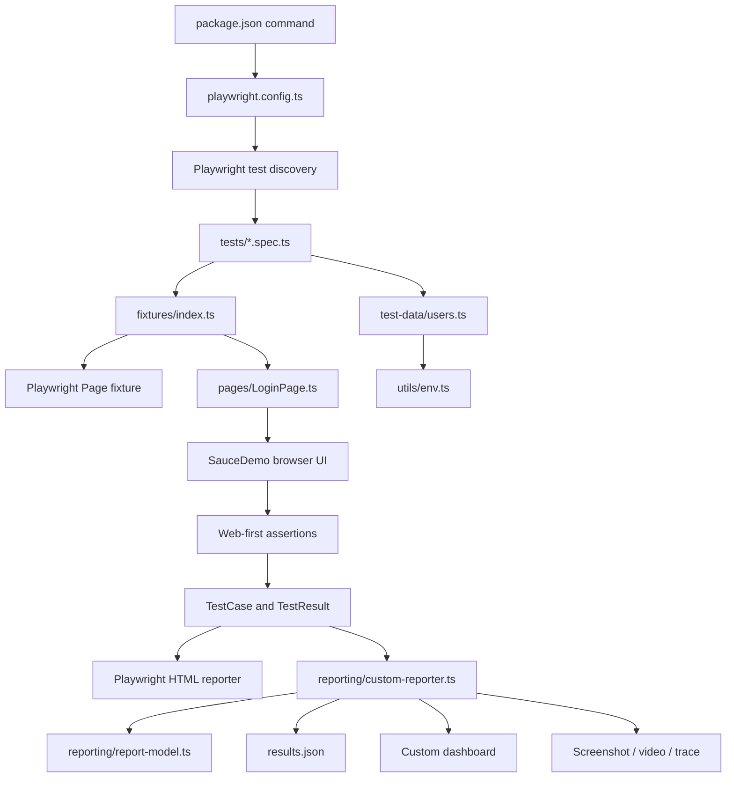

# 01 — Framework Architecture

## Prerequisites

- Know that an end-to-end test controls a browser and verifies user-visible behavior.
- Be able to run an npm command from the repository root.

## Learning objectives

After this lesson, you should be able to:

1. Explain the responsibility of every framework layer.
2. Trace a login scenario from an npm command to generated evidence.
3. Distinguish authored source, configuration, documentation, and generated output.
4. Identify which file should change for a selector, data, assertion, or report requirement.

## Framework at a glance



The arrows show **runtime data flow**, not inheritance. For example, the spec does not inherit from the page object. The fixture constructs a `LoginPage` and injects it into the test callback.

## Repository map

| Area | Actual file | Primary responsibility | Executes when |
|---|---|---|---|
| Commands | `package.json:6-16` | Maps names such as `test:regression` to CLI commands. | npm starts a script. |
| Type checking | `tsconfig.json:2-20` | Enables strict checks and selects TypeScript source. | `npm run typecheck` or editor analysis. |
| Runner policy | `playwright.config.ts:12-63` | Discovery, workers, retries, timeouts, browser, artifacts, and reporters. | Before test collection. |
| Scenarios | `tests/login.spec.ts:4-31` | Describes valid and invalid login behavior and pass/fail assertions. | Declarations register during collection; callbacks run per test. |
| Failure demo | `tests/demo/login-intentional-failure.spec.ts:4-23` | Produces one real, deliberately incorrect assertion for reporting practice. | Only when selected; excluded by `test:regression`. |
| Fixture | `fixtures/index.ts:4-14` | Adds a typed `loginPage` to Playwright's fixture graph. | Setup runs for each test that requests it. |
| Page Object | `pages/LoginPage.ts:3-25` | Owns login locators and browser actions. | Constructed by the fixture; methods run when called. |
| Test data | `test-data/users.ts:3-20` | Defines typed valid and invalid credentials. | Module import during collection. |
| Environment utility | `utils/env.ts:1-9` | Selects an environment value/fallback and rejects blanks. | Called while test data is imported. |
| Report context | `reporting/run-context.ts:3-17` | Defines report roots, staging, environment, and IST timezone. | Imported by runner configuration. |
| Report schema | `reporting/report-types.ts:1-146` | Types schema-v2 results, attempts, evidence, and history. | Compile time only; the resulting objects exist at runtime. |
| Report model | `reporting/report-model.ts:11-133` | Pure tag classification and aggregate calculations. | Custom reporter finalization and unit tests. |
| Report collector | `reporting/custom-reporter.ts:49-487` | Converts Playwright results into durable JSON/evidence/history. | Reporter lifecycle, mainly `onEnd`. |
| Report presentation | `reporting/dashboard-template.ts:10-678` | Generates the self-contained HTML dashboard. | Called by the custom reporter at run completion. |

## Separation of concerns

Each file has one main reason to change:

| Change request | Correct owner | Why |
|---|---|---|
| Username placeholder changed | `pages/LoginPage.ts` | Element identity belongs to the page abstraction. |
| Valid login should land on another URL | `tests/login.spec.ts` | The expected business outcome belongs to the scenario. |
| Use another standard credential in CI | Environment/secret configuration | Data should not require changing test mechanics. |
| Add a typed page object fixture | `fixtures/index.ts` | Fixture composition belongs to the custom runner. |
| Change trace retention | `playwright.config.ts` | Artifact policy is runner configuration. |
| Add a report hierarchy rule | `reporting/report-model.ts` | Classification and aggregation are pure report-model concerns. |
| Change dashboard layout | `reporting/dashboard-template.ts` | Presentation must not change test correctness. |

This is **separation of concerns**: a selector change should not require editing report code, and a visual dashboard change should not alter test behavior.

## Valid-login path, step by step

1. npm reads `package.json` and starts `playwright test`.
2. Node evaluates `playwright.config.ts:1-63`.
3. `dotenv/config` populates `process.env` before the configuration constants are calculated.
4. Playwright reads `testDir: "./tests"` at `playwright.config.ts:13`.
5. Importing `tests/login.spec.ts` also imports the custom fixture and test data.
6. `test.describe`, `test.beforeEach`, and `test(...)` register callbacks; no browser interaction has happened yet.
7. A worker schedules the valid test and creates an isolated browser context and `Page`.
8. The fixture receives that `page` and constructs `new LoginPage(page)` at `fixtures/index.ts:10`.
9. `beforeEach` calls `loginPage.goto()` at `tests/login.spec.ts:8-10`.
10. The test passes `users.standard` values to `loginPage.login()` at `tests/login.spec.ts:12-15`.
11. `LoginPage` fills username, fills password, and clicks Login in order.
12. The spec verifies both `/inventory.html` and the `Products` title at `tests/login.spec.ts:17-20`.
13. Playwright records the result and tears down test-scoped fixtures/context.
14. The list, native HTML, and custom reporters finish processing the invocation.

## Source versus generated output

```text
Authored source                         Generated output
-----------------------------------     --------------------------------
tests/, pages/, fixtures/               test-results/
test-data/, utils/                      playwright-report/
reporting/*.ts                          reports/<run-id>/results.json
playwright.config.ts                    reports/<run-id>/dashboard/
package.json, tsconfig.json             reports/<run-id>/screenshots/
learning-guide/*.md                     reports/<run-id>/videos|traces/
```

Do not fix a dashboard bug by editing `reports/<run-id>/dashboard/index.html`; that changes only one historical artifact. Fix `reporting/dashboard-template.ts`, verify it, and generate a new run.

## Implemented scope versus possible extensions

### Implemented now

- One Chromium Desktop project (`playwright.config.ts:57-62`).
- Two passing login scenarios.
- One intentionally failing demo assertion.
- Per-test `LoginPage` fixture.
- List, native HTML, and custom reporters.
- Failure-only screenshot, video, and trace retention.
- Immutable local report history.

### Not implemented

- Firefox or WebKit projects.
- CI workflow files.
- Hosted/database report retention.
- API, accessibility, visual, mobile, or performance coverage.
- Automated root-cause diagnosis.

Playwright may support those capabilities generally, but this repository does not currently implement them.

## Common architecture mistakes

1. **Importing `test` from `@playwright/test` in a spec** — the custom `loginPage` fixture will not exist.
2. **Putting assertions inside every page-object action** — valid and invalid scenarios can no longer reuse the same action cleanly.
3. **Putting browser actions at module scope** — they execute outside test isolation/lifecycle.
4. **Duplicating one test for Sanity and Regression** — tags already provide many-to-many suite membership.
5. **Editing generated reports** — generated files are evidence, not source.
6. **Treating the custom reporter as the result authority** — Playwright decides outcomes; the reporter observes and serializes them.

## Practical exercise

For each change below, name the first file you would inspect:

1. Login button accessible name changes.
2. CI should retry failed tests once instead of twice.
3. A test is counted twice in the overall dashboard.
4. Standard username should come from a different environment variable.

Suggested answers: `pages/LoginPage.ts`, `playwright.config.ts`, `reporting/report-model.ts`, and `test-data/users.ts`/`utils/env.ts` respectively.

## Comprehension questions

### 1. Why does the fixture create `LoginPage` instead of each spec constructing it?

**Answer:** The fixture centralizes dependency construction, preserves Playwright's per-test lifecycle, supplies compile-time typing, and removes repeated setup without hiding scenario-specific navigation or authentication.

### 2. Which layer decides whether a valid login passed?

**Answer:** The assertions in `tests/login.spec.ts`. `LoginPage` performs mechanics, and reporters record the outcome, but the spec defines the expected behavior.

### 3. Why can a dashboard display failure evidence without being responsible for the failure?

**Answer:** Playwright creates a failed `TestResult` when an action/assertion rejects. The custom reporter receives that already-decided outcome and serializes its errors, steps, and attachments.

## Related lessons

- [02 — TypeScript Fundamentals](02-typescript-fundamentals.md)
- [04 — Execution Flow](04-execution-flow.md)
- [08 — Debugging and Reporting](08-debugging-and-reporting.md)
