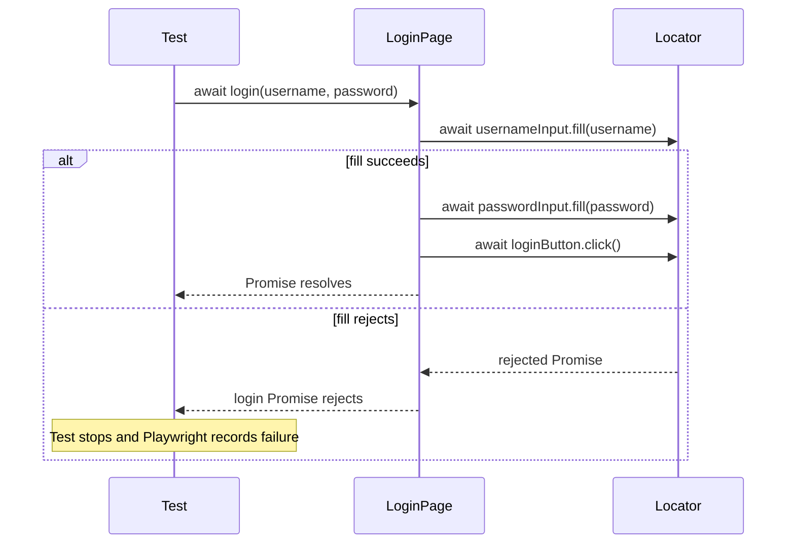
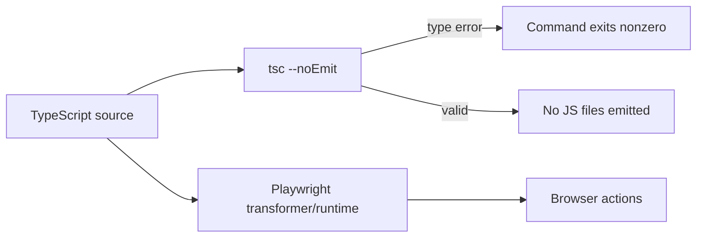

# 02 — TypeScript Fundamentals Used by This Framework

## Learning objectives

After this lesson, you should be able to:

1. Separate TypeScript/JavaScript syntax from Playwright APIs.
2. Explain the types, classes, functions, generics, and operators used in the repository.
3. Follow asynchronous failures through `async`/`await`.
4. Know which errors TypeScript catches and which require runtime testing.

## TypeScript versus Playwright

This distinction prevents a common beginner problem: calling every line in a test “Playwright syntax.”

| Example | Category | Meaning |
|---|---|---|
| `type UserCredentials = ...` | TypeScript | Defines a compile-time object shape. |
| `private readonly page: Page` | TypeScript | Declares a typed constructor parameter property. |
| `async` / `await` | JavaScript/TypeScript | Coordinates Promises. |
| `({ loginPage }) =>` | JavaScript destructuring | Extracts one property from an object argument. |
| `process.env.CI ? 2 : 0` | JavaScript conditional expression | Chooses a value based on CI state. |
| `base.extend<AppFixtures>(...)` | Playwright API with a TypeScript generic | Registers custom fixtures and type-checks their shape. |
| `page.getByRole(...)` | Playwright API | Creates a lazy locator. |
| `expect(locator).toHaveText(...)` | Playwright Test API | Repeatedly checks page state until pass/timeout. |

## Modules: imports and exports

```ts
import { expect, test } from "../fixtures";
import { users } from "../test-data/users";
```

From `tests/login.spec.ts:1-2`:

- `{ expect, test }` is a **named import**.
- `../fixtures` resolves to `fixtures/index.ts`.
- Importing from the custom fixture module is essential: its `test` includes `loginPage`.
- `users` is a runtime value, so importing it evaluates `test-data/users.ts`.

Compare that with:

```ts
import type { Locator, Page } from "@playwright/test";
```

At `pages/LoginPage.ts:1`, `import type` tells TypeScript these names are needed only for checking. They do not become runtime imports in emitted JavaScript.

### Import aliasing

```ts
import { test as base } from "@playwright/test";
```

At `fixtures/index.ts:1`, the imported `test` is renamed `base`. The file can then export its own extended value as `test`:

```ts
export const test = base.extend<AppFixtures>({ /* ... */ });
```

## Type aliases, object types, and `Readonly`

Actual code from `test-data/users.ts:3-6`:

```ts
export type UserCredentials = Readonly<{
  username: string;
  password: string;
}>;
```

Line-by-line:

| Syntax | Explanation |
|---|---|
| `export type` | Creates a reusable compile-time name and exposes it to other modules. |
| `UserCredentials` | Domain-specific name for the shape. |
| `Readonly<...>` | Prevents checked TypeScript code from reassigning properties. |
| `{ username: string; ... }` | Object type with two required string properties. |

`Readonly` does **not**:

- freeze the JavaScript object at runtime;
- encrypt the password;
- prevent the remote SauceDemo account from changing;
- stop values from appearing in logs or screenshots.

Those are separate runtime/security concerns.

## Classes and constructor parameter properties

```ts
export class LoginPage {
  readonly usernameInput: Locator;

  constructor(private readonly page: Page) {
    this.usernameInput = page.getByPlaceholder("Username", { exact: true });
  }
}
```

From `pages/LoginPage.ts:3-14`:

- `export class LoginPage` makes the class available to the fixture.
- `readonly usernameInput` means the locator reference cannot be reassigned after initialization.
- `private readonly page: Page` is a **parameter property**. TypeScript both accepts the constructor argument and creates/stores a private field.
- `this.usernameInput = ...` initializes an instance field.
- `new LoginPage(page)` at `fixtures/index.ts:10` creates one instance for a requesting test.

The constructor creates Locator objects but does not query the DOM yet. Laziness is Playwright behavior; the class/field syntax is TypeScript.

## Functions, parameters, and return types

### Synchronous utility

```ts
export function readEnv(name: string, fallback: string): string {
```

At `utils/env.ts:1`:

- `name: string` and `fallback: string` type the parameters.
- The final `: string` declares the return type.
- The function is synchronous because it returns a string immediately or throws.

### Asynchronous page-object method

```ts
async login(username: string, password: string): Promise<void> {
```

At `pages/LoginPage.ts:20`:

- `async` means the method always returns a Promise.
- `Promise<void>` means successful completion has no business value to return.
- The observable result is changed browser state.
- The Promise can still reject; `void` does not mean “cannot fail.”

## `async`, `await`, and failure propagation



Actual sequence at `pages/LoginPage.ts:21-23`:

```ts
await this.usernameInput.fill(username);
await this.passwordInput.fill(password);
await this.loginButton.click();
```

Each `await` pauses only the current async function. It does not block the entire Node.js process. If username filling rejects, password filling, clicking, and later test assertions do not execute.

### Why missing `await` is dangerous

```ts
// Incorrect: Promise is started but not awaited.
loginPage.login(users.standard.username, users.standard.password);

await expect(page).toHaveURL(/inventory/);
```

The assertion can race the unfinished login. The action may reject after the test has moved on, producing confusing or detached failures.

## Destructuring in test callbacks

```ts
test.beforeEach(async ({ loginPage }) => {
  await loginPage.goto();
});
```

Playwright passes one fixture object into the callback. `{ loginPage }` is object destructuring equivalent to:

```ts
async (fixtures) => {
  const loginPage = fixtures.loginPage;
}
```

The first form is concise and lets Playwright see which fixtures the callback requests.

## Generics in the custom fixture

```ts
type AppFixtures = {
  loginPage: LoginPage;
};

export const test = base.extend<AppFixtures>({
```

`<AppFixtures>` is a generic type argument. It tells Playwright's `extend` API the new fixture names and values. Benefits:

- `loginPage` autocompletes in tests.
- A misspelling such as `loginpage` becomes a type error.
- Supplying the wrong fixture value becomes a type error.
- The runtime fixture implementation and consumer share one contract.

## Operators used in configuration and utilities

| Operator/syntax | Actual use | Behavior |
|---|---|---|
| `??` | `process.env.BASE_URL ?? fallback` | Uses fallback only for `null`/`undefined`, not empty string. |
| `??=` | `process.env.PLAYWRIGHT_LAST_RUN_OUTPUT_FILE ??= ...` | Assigns only when current value is nullish. |
| `condition ? a : b` | `process.env.CI ? 2 : 0` | Selects CI retries/workers. |
| `Boolean(value)` | `forbidOnly: Boolean(process.env.CI)` | Converts presence/truthiness to boolean. |
| `...object` | `{ ...devices["Desktop Chrome"] }` | Copies enumerable device properties into a new object. |
| `` `${name}` `` | error/report strings | Interpolates values into a template literal. |
| `?.` | reporter optional properties | Stops and returns `undefined` if the left side is nullish. |
| `value as Type` | reporter JSON/error narrowing | Tells TypeScript how to treat a value; it performs no runtime validation. |

## Recursive and union types in reporting

The reporter uses more advanced TypeScript.

### String-literal union

```ts
export type DashboardStatus = "passed" | "failed" | "skipped" | "flaky";
```

Only those four strings satisfy the type. The dashboard and aggregation code can reason about a finite status set.

### Recursive type

```ts
export type StepRecord = {
  title: string;
  steps: StepRecord[];
};
```

A step can contain child steps of the same shape. This models Playwright's nested fixture, hook, API, `test.step`, and assertion records.

### Optional property

```ts
stack?: string;
```

The `?` means the property may be absent. Not every error contains every diagnostic field.

## Compile time versus runtime



`npm run typecheck` can catch:

- missing properties;
- wrong argument types;
- misspelled fixtures;
- incompatible return values;
- unsafe optional access under strict rules.

It cannot prove:

- that a locator matches the live DOM;
- that credentials are accepted;
- that the external website is available;
- that an assertion matches the product requirement;
- that a report link points to an existing copied artifact.

Those require runtime/unit/browser verification.

## Common mistakes

1. Assuming `Readonly` provides runtime security.
2. Omitting `await` on browser actions or assertions.
3. Using `any` to silence a useful type error.
4. Importing a type as a runtime value unnecessarily.
5. Calling a Playwright API “TypeScript syntax” or vice versa.
6. Using a type assertion (`as`) as if it validated unknown JSON.

## Comprehension questions

### 1. Is `base.extend<AppFixtures>` TypeScript or Playwright?

**Answer:** Both are involved. `base.extend(...)` is a Playwright runtime API; `<AppFixtures>` is a TypeScript generic argument that checks the custom fixture shape.

### 2. What happens if `STANDARD_USER` is set to spaces?

**Answer:** `??` preserves the non-null empty/whitespace string, then `readEnv` detects `value.trim() === ""` and throws during module import/collection, before browser interaction.

### 3. Why can a `Promise<void>` method fail?

**Answer:** `void` describes its resolved value, not its rejection behavior. Any awaited Playwright action can reject, which rejects the method's Promise and propagates to the test.

## Related lessons

- [03 — Playwright Fundamentals](03-playwright-fundamentals.md)
- [06 — Page Object Model](06-page-object-model.md)
- [07 — Fixtures and Test Data](07-fixtures-and-test-data.md)
