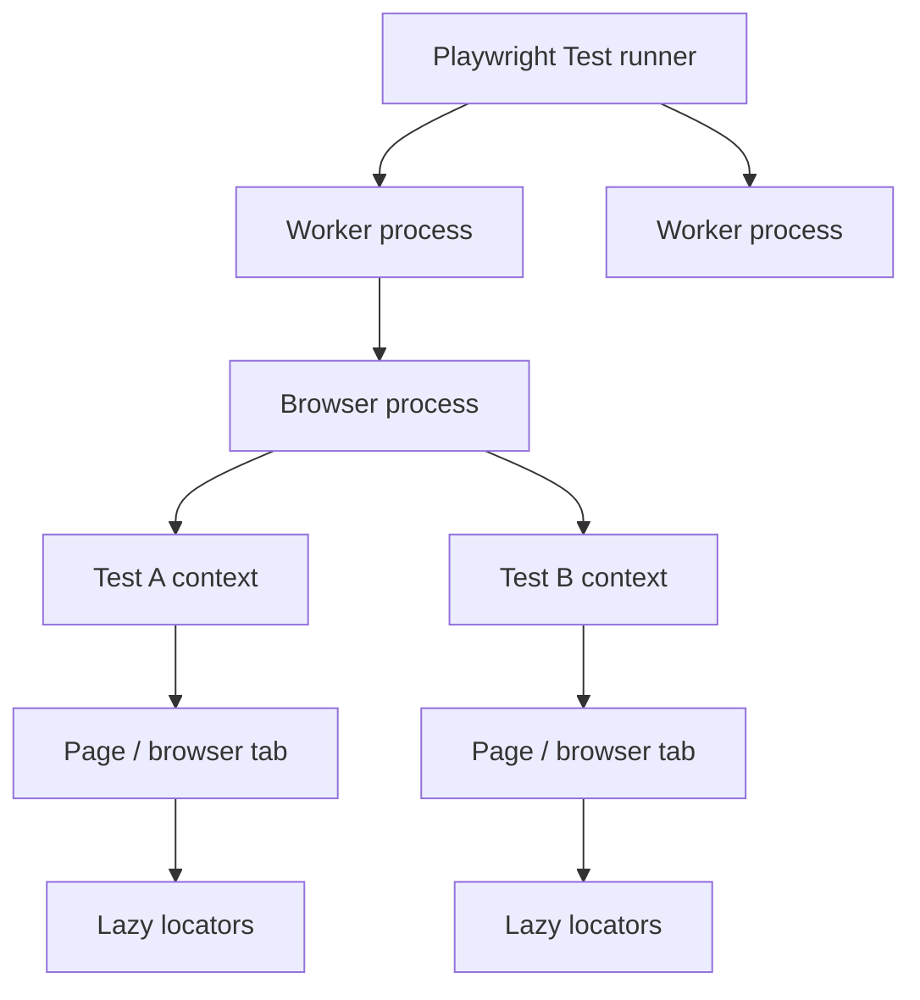
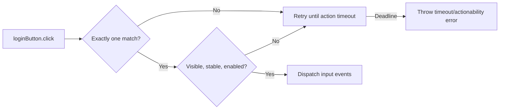

# 03 — Playwright Fundamentals in This Repository

## Learning objectives

After this lesson, you should be able to:

1. Explain the runner, worker, browser, context, page, and locator roles.
2. Distinguish action auto-waiting from assertion retrying.
3. Read the project's timeout, parallelism, tag, and browser configuration.
4. Predict how Playwright classifies a pass, failure, skip, or flaky retry.

## The Playwright object model



### Runner

The Playwright Test runner:

- loads configuration;
- discovers and filters tests;
- creates project-qualified test cases;
- schedules workers;
- resolves fixture dependencies;
- enforces timeouts and retries;
- evaluates assertions;
- sends lifecycle data to reporters.

### Worker

A worker is a Node.js process that executes tests. `fullyParallel: true` at `playwright.config.ts:15` permits independent tests to run concurrently. Source order is not a runtime ordering guarantee.

### Browser

A worker launches/reuses the configured browser. This repository defines only Chromium with Desktop Chrome settings at `playwright.config.ts:57-62`.

### Browser context

A context is an isolated browser profile. Each test receives fresh cookies, local storage, and pages. The valid login session therefore does not leak into the invalid-login test.

Context isolation does not isolate server-side shared accounts or backend state. Two contexts can still modify the same external user.

### Page

`Page` represents one browser tab. It is a built-in test-scoped fixture. The custom `loginPage` fixture depends on it at `fixtures/index.ts:9`.

### Locator

A Locator is a lazy query plan. Constructing this line does not immediately query the DOM:

```ts
this.loginButton = page.getByRole("button", { name: "Login", exact: true });
```

The query resolves when `click`, an assertion, or another consuming operation runs. This avoids stale element handles when the DOM changes.

## APIs used by the framework

| API | Actual location | Purpose |
|---|---|---|
| `defineConfig` | `playwright.config.ts:12` | Creates typed runner configuration. |
| `devices["Desktop Chrome"]` | `playwright.config.ts:60` | Supplies desktop browser-context defaults. |
| `test.describe` | `tests/login.spec.ts:4-31` | Groups tests and applies shared metadata. |
| `test.beforeEach` | `tests/login.spec.ts:8-10` | Navigates before each child scenario. |
| `test.step` | `tests/login.spec.ts:13-20` | Adds named runtime sections to traces/reports. |
| `base.extend` | `fixtures/index.ts:8-12` | Adds a custom fixture. |
| `page.goto` | `pages/LoginPage.ts:17` | Navigates to a URL. |
| `getByPlaceholder` | `pages/LoginPage.ts:10-11` | Locates inputs by visible placeholder. |
| `getByRole` | `pages/LoginPage.ts:12` | Locates the button by accessible role/name. |
| `getByTestId` | `pages/LoginPage.ts:13` | Uses the configured `data-test` attribute. |
| `fill` / `click` | `pages/LoginPage.ts:21-23` | Performs auto-waiting interactions. |
| `expect(...).toHaveURL` | `tests/login.spec.ts:18` | Retries a page URL condition. |
| `toHaveText` / `toContainText` | `tests/login.spec.ts:19,26-28` | Retries locator text conditions. |

## Auto-waiting for actions

Before an action, Playwright checks relevant **actionability** conditions.

For a typical `click`, Playwright waits for the locator to:

1. resolve to exactly one element;
2. be visible;
3. be stable (not moving/animating);
4. receive pointer events at the action point;
5. be enabled.

For `fill`, editability is also important.



The project sets `actionTimeout: 10_000` and `navigationTimeout: 15_000` at `playwright.config.ts:51-52`.

## Web-first assertion retrying

Actions and assertions wait for different reasons:

| Mechanism | Waits for | Example |
|---|---|---|
| Action auto-waiting | Element actionability | `loginButton.click()` |
| Navigation waiting | Requested navigation lifecycle | `page.goto("/")` |
| Web-first assertion | Expected state to become true | `expect(title).toHaveText("Products")` |
| Fixed sleep | Time only; no condition | `page.waitForTimeout(2000)` — avoid |

The project sets `expect: { timeout: 5_000 }` at `playwright.config.ts:20`. During that period, `toHaveText` re-resolves the locator and compares its current text. It can pass as soon as the condition is true; it does not always wait five seconds.

## Timeout hierarchy

| Setting | Value | Scope |
|---|---:|---|
| Test timeout | 30 seconds | Entire test, including fixtures/hooks/body. |
| Expect timeout | 5 seconds | One web-first assertion. |
| Action timeout | 10 seconds | One action such as `click` or `fill`. |
| Navigation timeout | 15 seconds | Navigation operations. |

A shorter nested timeout often fails first. For example, a wrong text expectation usually fails at five seconds even though the overall test has a 30-second budget.

## Tags and test selection

The login suite declares:

```ts
{ tag: ["@sanity", "@regression", "@module:authentication"] }
```

Both child tests inherit the metadata. The demo declares:

```ts
{ tag: ["@demo", "@regression", "@module:authentication"] }
```

Commands use that metadata:

```bash
npm run test:sanity
npm run test:regression
```

`test:regression` includes `@regression` and excludes `@demo`, so it runs the two production-style scenarios without the deliberate failure.

## Parallelism, retries, and isolation

```ts
fullyParallel: true,
forbidOnly: Boolean(process.env.CI),
retries: process.env.CI ? 2 : 0,
workers: process.env.CI ? 1 : undefined,
```

From `playwright.config.ts:15-18`:

- Local runs use Playwright's default worker count and no retries.
- CI uses one worker and up to two retries.
- CI fails if a committed `.only` would limit coverage.
- A failed first attempt followed by a pass is **flaky**, not a clean pass.

Retries are diagnostic evidence and infrastructure mitigation; they are not a fix for unstable tests.

## Test outcome concepts

| Playwright situation | Dashboard status |
|---|---|
| Expected-to-pass test passes first attempt | `passed` |
| Test has an unexpected failure | `failed` |
| Test does not execute/is skipped | `skipped` |
| First attempt fails and retry passes | `flaky` |

The custom reporter maps `test.outcome()` to these values at `reporting/custom-reporter.ts:285-291`.

## Steps and trace readability

`test.step` does not change pass/fail semantics. It gives the action group a meaningful name:

```ts
await test.step("Verify the inventory page", async () => {
  await expect(page).toHaveURL(/\/inventory\.html$/);
  await expect(page.getByTestId("title")).toHaveText("Products");
});
```

That title appears in Playwright's step tree, native report, trace, and custom dashboard. If the URL assertion fails, the title assertion never runs because the step callback rejects at the first awaited failure.

## What can still go wrong

- The public site can be unavailable.
- Shared accounts can have server-side collisions despite fresh contexts.
- User-visible copy can change.
- A locator can become ambiguous.
- A forced action can hide a real usability defect.
- CI-only retries can reveal/hide flaky first attempts.
- Chromium success says nothing about Firefox/WebKit until projects are configured.

## Comprehension questions

### 1. Why can two tests share a browser process but remain isolated?

**Answer:** Each test receives a separate browser context with independent cookies and storage. Browser-process reuse improves speed without sharing profile state.

### 2. Why is a Locator safer than storing a DOM element handle early?

**Answer:** A Locator re-evaluates against the current DOM at action/assertion time, so page updates do not leave it pointing at a stale node.

### 3. Does auto-waiting make assertions unnecessary?

**Answer:** No. Auto-waiting proves an action was possible; it does not prove the required business outcome. The spec still needs web-first assertions for URL, title, or error behavior.

## Related lessons

- [04 — Execution Flow](04-execution-flow.md)
- [05 — Locators and Assertions](05-locators-and-assertions.md)
- [08 — Debugging and Reporting](08-debugging-and-reporting.md)
