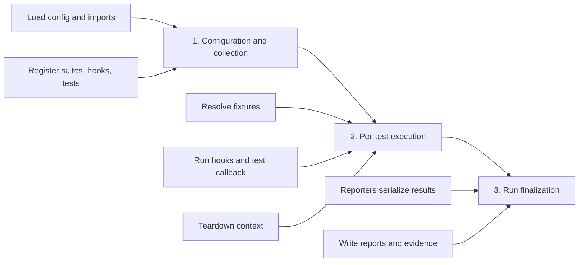
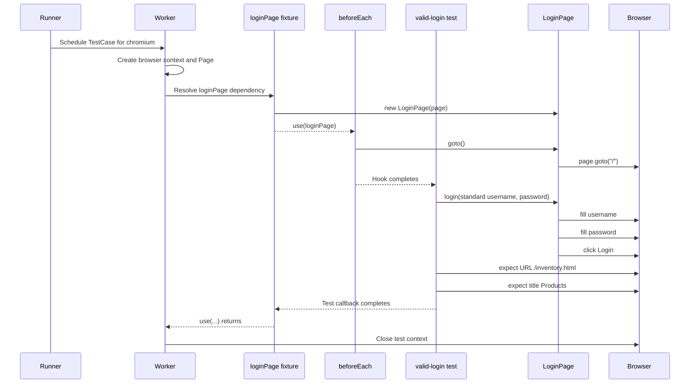
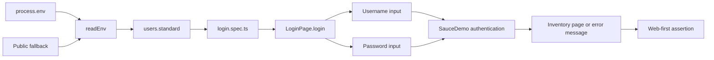
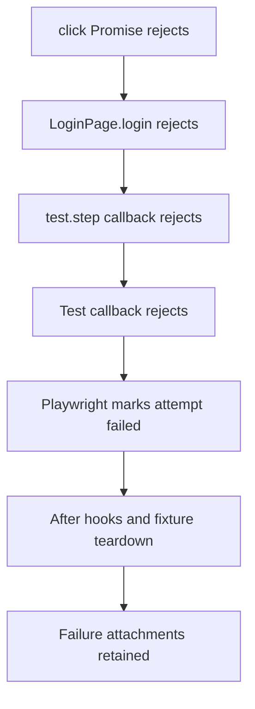
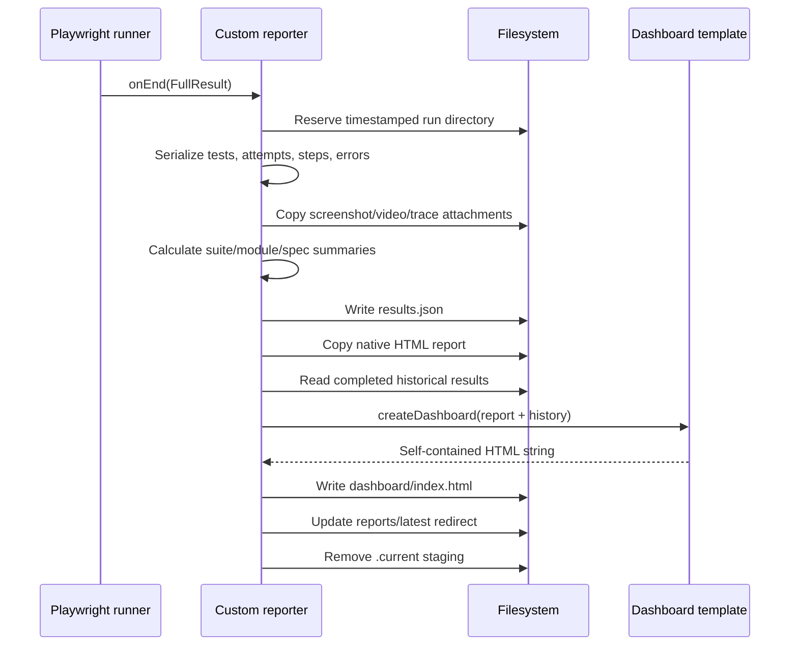

# 04 — Runtime Execution Flow and Data Flow

## Learning objectives

After this lesson, you should be able to:

1. Separate configuration/collection time from per-test execution time.
2. Order fixture setup, hooks, test steps, assertions, teardown, and reporter finalization.
3. Trace credentials and browser state through the framework.
4. Predict what does not run after an awaited operation fails.

## Three major phases



Understanding these phases explains why some failures produce screenshots/traces and other failures occur before a browser exists.

## Phase 1: configuration and collection

No test body has executed yet.

1. npm resolves a script from `package.json:6-16`.
2. Playwright loads `playwright.config.ts`.
3. `import "dotenv/config"` executes first and populates `process.env`.
4. `reportingSettings` is imported from `reporting/run-context.ts`.
5. `baseURL`, staging paths, retries, workers, projects, and reporters are calculated.
6. Playwright discovers files under `./tests`.
7. Importing `tests/login.spec.ts` imports:
   - `fixtures/index.ts`;
   - `pages/LoginPage.ts` through the fixture;
   - `test-data/users.ts`;
   - `utils/env.ts` through test data.
8. `users.standard` is built immediately at module scope (`test-data/users.ts:8-20`).
9. `test.describe`, `beforeEach`, and each `test` register callback functions.

### Module-scope code versus callback code

```ts
// Runs during module import/collection:
export const users = {
  standard: {
    username: readEnv("STANDARD_USER", "standard_user"),
  },
};

// Registered during collection, runs later per test:
test("standard user can log in", async ({ loginPage }) => {
  await loginPage.login(/* ... */);
});
```

If `readEnv` throws because an environment override is blank, collection fails before the test callback and before failure-only browser artifacts can be captured.

## Phase 2: one valid-login test



### Exact runtime order

1. Playwright selects the Chromium project.
2. A worker obtains a browser.
3. Built-in fixtures create a fresh context and page.
4. The custom fixture callback starts because `loginPage` is requested.
5. `new LoginPage(page)` stores the page and creates four lazy locators.
6. `await use(loginPage)` hands control to dependent hooks and the test.
7. `beforeEach` navigates to `/`.
8. The test's `Submit valid credentials` step runs.
9. `login()` fills, fills, and clicks sequentially.
10. The `Verify the inventory page` step runs two assertions sequentially.
11. The test callback resolves.
12. Control returns through `use`; custom teardown would run here if present.
13. Built-in page/context teardown runs.
14. The attempt's status and attachments are complete.

## Fixture `use` as a lifecycle boundary

Actual fixture (`fixtures/index.ts:8-12`):

```ts
export const test = base.extend<AppFixtures>({
  loginPage: async ({ page }, use) => {
    await use(new LoginPage(page));
  },
});
```

Conceptually:

```ts
loginPage: async ({ page }, use) => {
  // Setup executes before dependent hooks/test.
  const loginPage = new LoginPage(page);

  await use(loginPage);
  // The dependent lifecycle runs while use is awaited.

  // Teardown would execute here.
}
```

The current fixture owns no external resource, so it needs no custom teardown. Playwright tears down its built-in page/context fixtures.

## Credential data flow



Side effects occur only in the browser action layer. `readEnv` and `users` prepare strings; the spec chooses data; `LoginPage` writes it into the page.

## Promise rejection propagation

Suppose `loginButton.click()` at `pages/LoginPage.ts:23` times out:



The following do **not** run:

- the next statement in `login()`;
- the next statement in the current test step;
- later test steps/assertions in the test body.

Teardown still runs because Playwright owns the fixture lifecycle.

## Intentional-failure execution flow

The demo at `tests/demo/login-intentional-failure.spec.ts` is deliberately structured so that setup and actions pass before the assertion fails.

| Order | Step | Expected result |
|---:|---|---|
| 1 | Fixture constructs `LoginPage` | Pass |
| 2 | `Open the login page` | Pass |
| 3 | `Submit invalid credentials` | Pass |
| 4 | Error locator resolves to visible message | Pass |
| 5 | Compare against `Account locked after invalid login` | Fail after expect timeout |
| 6 | Context teardown retains screenshot/video/trace | Runs despite failure |
| 7 | Reporters serialize attempt and evidence | Runs at invocation finalization |

The observed application text is `Username and password do not match...`, while the expected text is deliberately unrelated. This is an **automation expectation mismatch by design**, not a locator failure.

## Phase 3: reporter finalization

After all tests/attempts are complete:



Reporters do not run inside `LoginPage.login()`. They observe Playwright events and finalize after attempts have complete data.

## Parallel execution implications

Because `fullyParallel` is true:

- terminal order can differ from source order;
- tests can run in different workers;
- one test must never depend on another test's login/session;
- shared server-side data remains a possible collision;
- report records include worker/project identity rather than assuming sequential execution.

To simplify one investigation—not as a permanent reliability workaround—run:

```bash
npx playwright test --grep "standard user can log in" --workers=1
```

## Failure location guide

| Failure phase | Typical symptom | Likely first investigation |
|---|---|---|
| Config import | Cannot load config/module | Import path, dotenv, TypeScript syntax |
| Collection | No test starts; data utility throws | Environment and module-scope code |
| Fixture setup | Failure under Before Hooks/fixture | Fixture dependency/construction |
| Navigation | `page.goto` timeout/network error | Base URL, network, external site |
| Action | Locator/actionability timeout | DOM, selector uniqueness, visibility |
| Assertion | Expected/received mismatch | Requirement, app behavior, data |
| Reporter finalization | Tests ran but output incomplete | Filesystem paths, reporter exception |

## Comprehension questions

### 1. When is `users.standard` created?

**Answer:** During module import in the collection phase, not when the test first reads it.

### 2. If the final assertion fails, does fixture teardown still run?

**Answer:** Yes. The rejected test callback returns control through Playwright's managed fixture lifecycle, and teardown/attachment finalization still occurs.

### 3. Why might a collection failure have no screenshot?

**Answer:** The failure can occur before a browser context/page/test attempt exists, so the failure-only screenshot policy has nothing to capture.

## Related lessons

- [07 — Fixtures and Test Data](07-fixtures-and-test-data.md)
- [08 — Debugging and Reporting](08-debugging-and-reporting.md)
