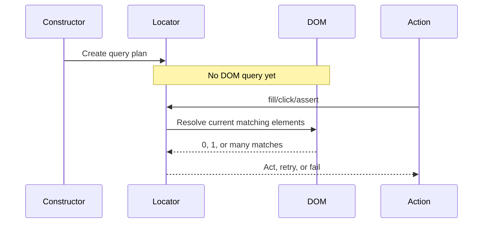
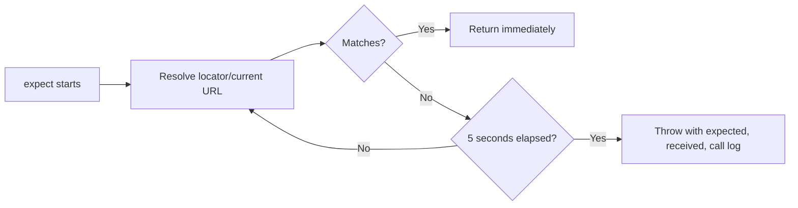

# 05 — Locators, Actions, and Assertions

## Learning objectives

After this lesson, you should be able to:

1. Explain every locator used by `LoginPage`.
2. Choose semantic locators before CSS/XPath.
3. Distinguish exact text, substring text, and regular-expression assertions.
4. Debug strictness, actionability, and assertion failures from Playwright evidence.

## Current locator strategy

Actual code at `pages/LoginPage.ts:9-14`:

```ts
constructor(private readonly page: Page) {
  this.usernameInput = page.getByPlaceholder("Username", { exact: true });
  this.passwordInput = page.getByPlaceholder("Password", { exact: true });
  this.loginButton = page.getByRole("button", { name: "Login", exact: true });
  this.errorMessage = page.getByTestId("error");
}
```

## Line-by-line locator explanation

| Line | Playwright behavior | Why this locator was chosen | Failure risk |
|---|---|---|---|
| `getByPlaceholder("Username", { exact: true })` | Lazily finds an input whose placeholder exactly matches `Username`. | User-visible identity; readable in reports/traces. | Placeholder copy or duplicate exact placeholders. |
| `getByPlaceholder("Password", { exact: true })` | Same strategy for the password input. | Avoids CSS implementation details. | Localization/copy changes. |
| `getByRole("button", { name: "Login", exact: true })` | Uses accessibility role plus accessible name. | Closely matches how assistive technology/users identify the control. | Accessible-name regression or duplicate Login buttons. |
| `getByTestId("error")` | Resolves the configured test-ID attribute. | The error has a stable automation identifier. | Config/DOM test-ID contract changes. |

## Why `getByTestId` uses `data-test`

Playwright defaults to `data-testid`, but this project overrides it:

```ts
use: {
  testIdAttribute: "data-test",
}
```

At `playwright.config.ts:48-50`, this makes:

```ts
page.getByTestId("error")
```

equivalent in intent to locating an element with:

```html
data-test="error"
```

This is a cross-file interaction: changing `testIdAttribute` can break page-object locators even if `LoginPage.ts` is unchanged.

## Locator priority for this framework

Prefer:

1. role + accessible name;
2. label;
3. placeholder or visible text when stable;
4. stable test ID;
5. carefully scoped CSS;
6. XPath only when no meaningful contract exists.

This is guidance, not a mechanical rule. A stable `data-test` can be safer than frequently changing marketing copy. The key is to choose a locator that represents a stable user or automation contract.

## Lazy resolution



Benefits:

- the DOM may update between construction and action;
- Playwright retries current state rather than holding a stale node;
- the same locator can be used across multiple checks;
- locator details appear in call logs and traces.

## Strictness

Actions that require one target fail if a locator resolves to multiple elements. Playwright does not silently guess.

If `getByRole("button", { name: "Login" })` matches two buttons:

1. inspect both elements and their accessible names;
2. decide which identity should be unique;
3. refine using a meaningful parent/attribute/name;
4. do not use `.first()` merely to suppress the error unless position is truly the requirement.

## Actions and actionability

Actual action method:

```ts
async login(username: string, password: string): Promise<void> {
  await this.usernameInput.fill(username);
  await this.passwordInput.fill(password);
  await this.loginButton.click();
}
```

Playwright waits for each action's required conditions. If the username input is present but disabled, `fill` waits until its action timeout and reports why it could not proceed.

### Avoid `{ force: true }` as a default fix

Forced actions skip some actionability checks. That can make automation interact with a control that a real user cannot use. Use force only when the requirement explicitly involves such behavior and the tradeoff is documented.

## Current assertions

### Valid login

```ts
await expect(page).toHaveURL(/\/inventory\.html$/);
await expect(page.getByTestId("title")).toHaveText("Products");
```

At `tests/login.spec.ts:18-19`:

- `toHaveURL` repeatedly reads the page URL.
- `/\/inventory\.html$/` is a JavaScript regular expression.
- `\.` means a literal dot.
- `$` anchors the match at the end of the URL.
- `toHaveText("Products")` requires normalized element text to match exactly.

Using URL **and** title is stronger than either alone:

- a URL-only test might pass on a broken/blank inventory page;
- a title-only check could theoretically match in an unexpected context;
- both prove navigation and meaningful destination content.

### Invalid login

```ts
await expect(loginPage.errorMessage).toContainText(
  "Username and password do not match",
);
```

At `tests/login.spec.ts:26-28`, `toContainText` intentionally checks the behavior-defining substring. SauceDemo prefixes the visible message with `Epic sadface:` and includes additional copy. Exact full-text matching would couple the test to irrelevant decoration.

## Exact versus substring versus regex

| Matcher | Use when | Current example |
|---|---|---|
| `toHaveText("Products")` | Entire normalized text is the contract. | Inventory title. |
| `toContainText("Username and password do not match")` | A stable identifying phrase is the contract. | Login error. |
| `toHaveURL(/...$/)` | URL needs a structural/pattern check. | Inventory route. |

Do not weaken an assertion only to make it green. First decide what product behavior the test must prove.

## Assertion retry timeline



The intentional failure demonstrates this behavior. Its error locator resolves repeatedly, but the wrong expected substring never appears. The result is an assertion timeout—not a locator timeout.

## Failure diagnosis matrix

| Evidence | Meaning | First question |
|---|---|---|
| `waiting for getBy...` with zero matches | Locator cannot resolve. | Did identity/DOM/frame change? |
| Strict mode violation/multiple elements | Locator is ambiguous. | Which semantic identity should be unique? |
| Element resolved but not editable | Actionability problem. | Is it disabled, covered, or wrong element? |
| Expected/received text shown repeatedly | Locator works; state/expectation differs. | Is app, data, or requirement wrong? |
| URL remains login page | Login did not navigate. | Credentials, response, app defect, or environment? |
| Only parallel execution fails | Likely shared external/backend state. | Which account/file/resource is shared? |

## Flakiness traps

### Fixed sleeps

```ts
// Avoid:
await page.waitForTimeout(5000);
await expect(title).toHaveText("Products");
```

It always wastes five seconds when the app is fast and still fails if the app takes 5.1 seconds. The assertion already waits for the condition.

### Positional selectors

```ts
// Fragile if layout changes:
page.locator("button").nth(1);
```

Prefer the Login button's user-facing identity.

### Over-broad text

```ts
// Too weak; could match unrelated content:
await expect(page.locator("body")).toContainText("Product");
```

Target the actual title contract instead.

## Practical debugging exercise

Temporarily change the valid title assertion from `Products` to `All Products`, run only that test, and inspect:

```bash
npx playwright test --grep "standard user can log in" --workers=1
```

Before restoring the source, answer:

1. Did the title locator resolve?
2. What expected and received strings appear?
3. Which screenshot state was captured?
4. Does the trace show successful login before the assertion?
5. Is this an application defect or a deliberately wrong test expectation?

## Comprehension questions

### 1. Why does `exact: true` not make the locator execute immediately?

**Answer:** `exact` changes matching semantics; Locator resolution remains lazy until an action or assertion consumes it.

### 2. The error element resolves 14 times but text never matches. Is the selector broken?

**Answer:** No. Repeated successful resolution proves the selector works. The received page text or expected requirement is different.

### 3. Why is `waitForTimeout` not a substitute for `toHaveText`?

**Answer:** A fixed sleep observes no condition. `toHaveText` retries the actual expected state, passes as soon as it is true, and reports expected/received diagnostics at its deadline.

## Related lessons

- [03 — Playwright Fundamentals](03-playwright-fundamentals.md)
- [06 — Page Object Model](06-page-object-model.md)
- [08 — Debugging and Reporting](08-debugging-and-reporting.md)
