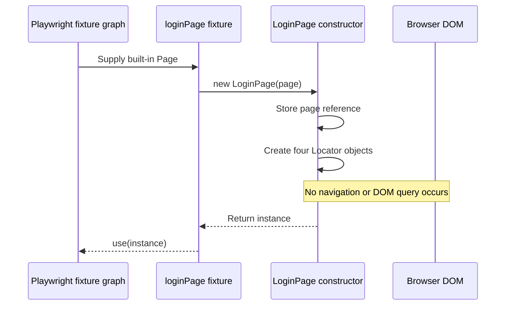
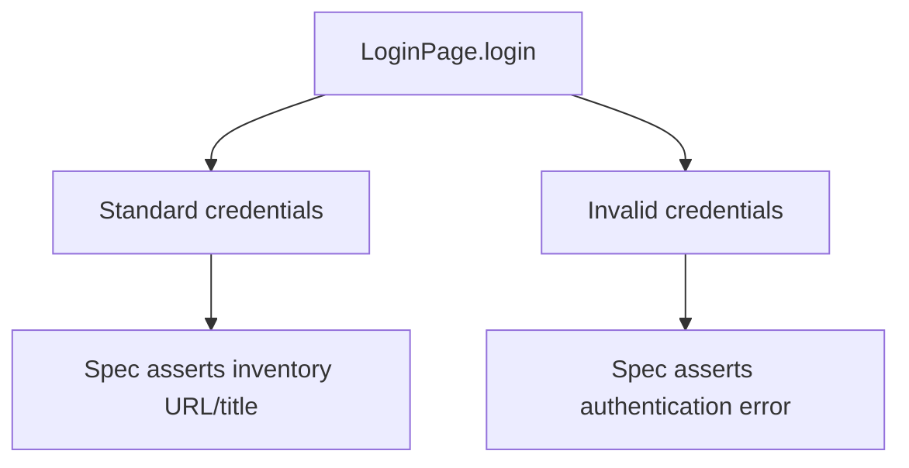

# 06 — Page Object Model

## Learning objectives

After this lesson, you should be able to:

1. Explain every field and method in `LoginPage`.
2. Describe what the constructor does—and does not do—at runtime.
3. Decide whether logic belongs in a page object or a spec.
4. Recognize over-abstraction and “god page object” risks.

## What a page object represents

The Page Object Model (POM) represents one UI area as:

- element identity (Locators);
- meaningful user actions;
- optional repeated page-specific queries.

It is not:

- a replacement for assertions;
- a base class requirement;
- a place for unrelated workflows;
- a way to hide every Playwright API from tests.

## Complete current page object

```ts
import type { Locator, Page } from "@playwright/test";

export class LoginPage {
  readonly usernameInput: Locator;
  readonly passwordInput: Locator;
  readonly loginButton: Locator;
  readonly errorMessage: Locator;

  constructor(private readonly page: Page) {
    this.usernameInput = page.getByPlaceholder("Username", { exact: true });
    this.passwordInput = page.getByPlaceholder("Password", { exact: true });
    this.loginButton = page.getByRole("button", { name: "Login", exact: true });
    this.errorMessage = page.getByTestId("error");
  }

  async goto(): Promise<void> {
    await this.page.goto("/");
  }

  async login(username: string, password: string): Promise<void> {
    await this.usernameInput.fill(username);
    await this.passwordInput.fill(password);
    await this.loginButton.click();
  }
}
```

Source: `pages/LoginPage.ts:1-25`.

## Line-by-line responsibilities

| Lines | What | Why | When |
|---|---|---|---|
| 1 | Imports `Locator` and `Page` as types. | Enables strict typing without a runtime import. | Type checking/module transform. |
| 3 | Exports `LoginPage`. | Fixture can import and instantiate it. | Class definition during module load. |
| 4-7 | Declares four readonly Locator fields. | Centralizes login element identity and exposes the error for assertions. | Fields initialize per instance. |
| 9 | Stores the injected Playwright `Page`. | Methods need one isolated browser tab. | Fixture calls constructor. |
| 10-13 | Creates lazy locator plans. | Reuse and maintain selectors in one place. | Constructor; no DOM query yet. |
| 16-18 | Defines navigation to relative `/`. | Uses config `baseURL`; keeps navigation mechanics in POM. | Hook or demo step calls it. |
| 20-24 | Defines credential submission. | Reuses identical mechanics for valid and invalid scenarios. | Test calls it after navigation. |

## Constructor runtime



Important distinction:

- **TypeScript class construction** creates the object and stores locators.
- **Playwright locator consumption** later queries the live DOM during `fill`, `click`, or assertion.

## Why `goto` uses a relative URL

```ts
await this.page.goto("/");
```

Because `baseURL` is configured at `playwright.config.ts:49`, Playwright resolves `/` against:

```ts
const baseURL = process.env.BASE_URL ?? "https://www.saucedemo.com";
```

This allows environment changes without editing the page object. If `BASE_URL` is invalid, the page object still compiles, but navigation fails at runtime.

## Why `login` is outcome-neutral

The same method supports two different outcomes:



If the method were named `loginAndVerifySuccess`, the invalid-login test could not reuse it without conflicting assumptions.

## Why business assertions stay in specs

Valid scenario:

```ts
await loginPage.login(users.standard.username, users.standard.password);
await expect(page).toHaveURL(/\/inventory\.html$/);
await expect(page.getByTestId("title")).toHaveText("Products");
```

Invalid scenario:

```ts
await loginPage.login(users.invalid.username, users.invalid.password);
await expect(loginPage.errorMessage).toContainText(
  "Username and password do not match",
);
```

Keeping these assertions in `tests/login.spec.ts` makes review direct: the reader sees exactly what each scenario proves. A page-object assertion helper can be appropriate when the same complex outcome is repeated many times, but it should not hide essential test intent.

## Public locators: useful but controlled

The four locator fields are public `readonly`. That supports beginner visibility and allows:

```ts
expect(loginPage.errorMessage)
```

Tradeoff: tests could bypass meaningful methods and manipulate inputs directly everywhere. In a larger framework, expose only locators that tests genuinely need for readable assertions, or provide focused query helpers.

`readonly` prevents reassignment of the Locator property; it does not make the page immutable.

## Good versus weak page-object APIs

| API | Assessment | Reason |
|---|---|---|
| `login(username, password)` | Good | Names user intent and hides mechanics. |
| `goto()` | Acceptable here | Page-specific navigation with configured base URL. |
| `clickButton(name)` | Weak | Exposes generic mechanics rather than domain behavior. |
| `fillInput(selector, value)` | Weak | Duplicates Playwright and leaks selectors to callers. |
| `loginAndAssertProducts()` | Too coupled | Cannot support invalid login and hides expected outcome. |
| `doEverything()` | Poor | No clear contract or responsibility. |

## When to add another page object

Add one when a distinct page or reusable UI component has its own:

- stable locators;
- meaningful actions;
- repeated usage across scenarios.

Example future structure (not currently implemented):

```text
pages/
├── LoginPage.ts
├── InventoryPage.ts
└── components/
    └── CartBadge.ts
```

Do not add these files until tests require the behavior.

## Why there is no `BasePage`

The current framework has one page object and no demonstrated cross-page duplication. A base class now would add:

- inheritance decisions;
- indirect method ownership;
- broader change impact;
- little or no removed duplication.

Prefer composition and proven reuse. Add an abstraction after repeated need appears, not in anticipation of it.

## Failure boundaries

| Failure | Layer likely responsible |
|---|---|
| Constructor throws immediately | TypeScript/JavaScript object setup or fixture input |
| `goto` network timeout | Environment/base URL/network/external service |
| Username fill timeout | Locator or page readiness |
| Login click actionability failure | Locator, overlay, disabled control, app behavior |
| Click passes but URL is wrong | Credentials, app response, environment, assertion requirement |
| Error locator resolves but text differs | Product copy or expected requirement |

## Anti-pattern review

### Hidden assertion

```ts
// Avoid for this framework:
async login(username: string, password: string) {
  // actions...
  await expect(this.page).toHaveURL(/inventory/);
}
```

This makes `login()` unusable for expected failures and obscures the spec's proof.

### Constructor side effects

```ts
// Avoid:
constructor(page: Page) {
  this.page = page;
  void this.page.goto("/");
}
```

Constructors cannot be awaited, so navigation becomes an uncontrolled Promise. Keep async side effects in explicit async methods.

### God object

One class should not own login, inventory, cart, checkout, reporting, and test data. Split by cohesive UI responsibilities.

## Comprehension questions

### 1. Does `new LoginPage(page)` prove that the Username input exists?

**Answer:** No. It creates a Locator query plan. Existence is checked later when an action/assertion resolves the locator.

### 2. Why does `login()` return `Promise<void>`?

**Answer:** It performs asynchronous browser side effects and has no business value to return. The resulting page state is verified separately by the spec.

### 3. When would a page-level assertion helper be justified?

**Answer:** When a genuinely repeated, page-specific verification can be named clearly and reused without hiding each scenario's essential outcome.

## Related lessons

- [05 — Locators and Assertions](05-locators-and-assertions.md)
- [07 — Fixtures and Test Data](07-fixtures-and-test-data.md)
- [09 — Code Review Checklist](09-code-review-checklist.md)
