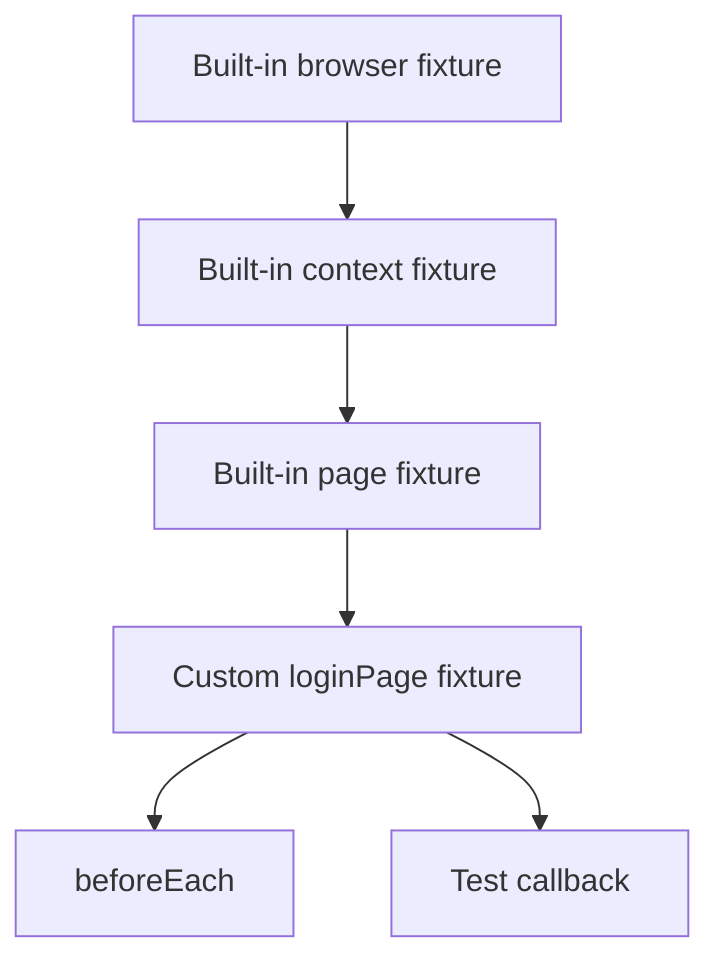
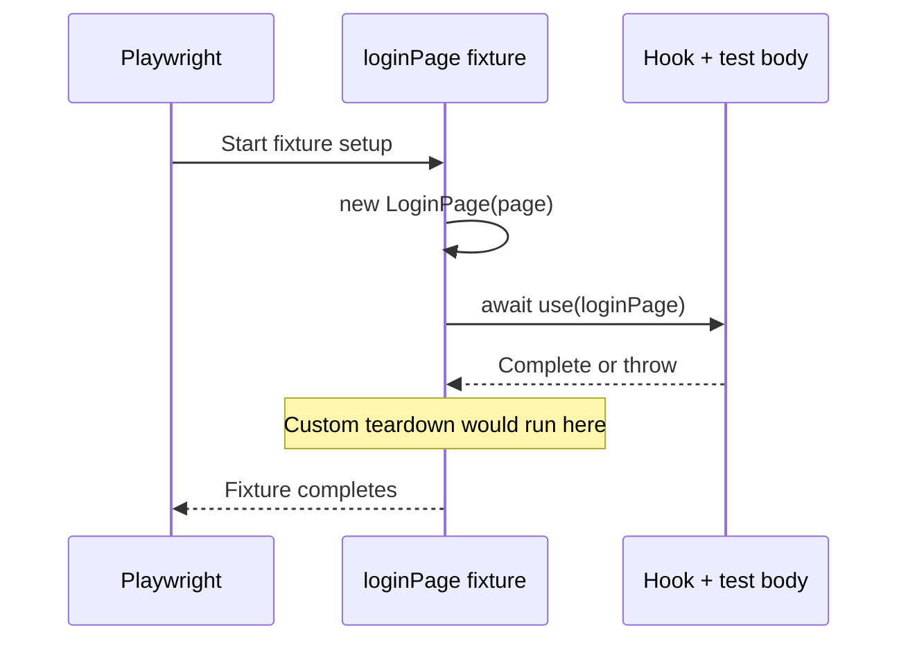
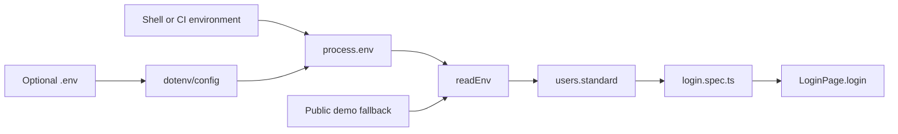

# 07 — Fixtures, Environment, and Test Data

## Learning objectives

After this lesson, you should be able to:

1. Explain how the custom fixture extends Playwright's built-in fixture graph.
2. Describe setup, `use`, and teardown boundaries.
3. Trace environment values into a browser input.
4. Review test data for isolation, configuration, and secret-handling risks.

## What is a Playwright fixture?

A fixture is a managed dependency with a lifecycle. Playwright supplies built-in fixtures such as `browser`, `context`, and `page`. This repository adds `loginPage`.

Fixtures can provide:

- browser objects;
- page objects;
- prepared data;
- temporary resources;
- setup and guaranteed teardown boundaries.

## Current custom fixture

```ts
import { test as base } from "@playwright/test";
import { LoginPage } from "../pages/LoginPage";

type AppFixtures = {
  loginPage: LoginPage;
};

export const test = base.extend<AppFixtures>({
  loginPage: async ({ page }, use) => {
    await use(new LoginPage(page));
  },
});

export { expect } from "@playwright/test";
```

Source: `fixtures/index.ts:1-14`.

## Line-by-line fixture explanation

| Lines | TypeScript/Playwright meaning | Runtime effect |
|---|---|---|
| 1 | Imports Playwright `test` and aliases it to `base`. | Loads the built-in test/fixture API during collection. |
| 2 | Imports the runtime `LoginPage` class. | Makes constructor available to fixture setup. |
| 4-6 | Defines the custom fixture type. | Compile-time only; tests learn that `loginPage` exists. |
| 8 | Calls Playwright `base.extend<AppFixtures>`. | Creates a new test function with added fixtures. |
| 9 | Declares `loginPage` dependency on built-in `page`. | Playwright resolves `page` before this fixture. |
| 10 | Constructs and supplies `LoginPage`. | The dependent hook/test runs while `use` is awaited. |
| 14 | Re-exports Playwright's `expect`. | Specs import test and assertion API from one module. |

## Fixture dependency graph



Playwright resolves dependencies automatically. A test that does not request `loginPage` would not activate this fixture.

## The `use` boundary



For a resource-owning fixture, a safe pattern would be:

```ts
resource: async ({}, use) => {
  const resource = await createResource();
  try {
    await use(resource);
  } finally {
    await resource.dispose();
  }
}
```

The current `loginPage` fixture does not create an external resource. It wraps the built-in `page`, whose lifecycle Playwright already manages.

## Why the fixture does not navigate or log in

It would be possible to write:

```ts
loginPage: async ({ page }, use) => {
  const loginPage = new LoginPage(page);
  await loginPage.goto();
  await loginPage.login(/* standard user */);
  await use(loginPage);
}
```

That is intentionally not done because:

- the invalid-login test needs a logged-out page;
- the demo needs explicit named navigation and submission steps;
- hidden authentication would obscure scenario preconditions;
- fixture setup failures would be harder to distinguish from test behavior.

The current boundary removes repeated object construction while leaving behavior visible in hooks/specs.

## Why specs import from `../fixtures`

Correct:

```ts
import { expect, test } from "../fixtures";
```

Incorrect for a test that needs `loginPage`:

```ts
import { expect, test } from "@playwright/test";
```

The second import uses Playwright's unextended base test. TypeScript reports that `loginPage` does not exist in the callback fixture object.

## Typed test data

```ts
export type UserCredentials = Readonly<{
  username: string;
  password: string;
}>;

export const users: Readonly<{
  standard: UserCredentials;
  invalid: UserCredentials;
}> = {
  standard: {
    username: readEnv("STANDARD_USER", "standard_user"),
    password: readEnv("STANDARD_PASSWORD", "secret_sauce"),
  },
  invalid: {
    username: "invalid_user",
    password: "invalid_password",
  },
};
```

Source: `test-data/users.ts:3-20`.

Benefits:

- credentials are separate from scenario logic;
- the standard account can be overridden without source changes;
- invalid input is deterministic;
- required data keys and string types are compiler-checked.

## Environment loading flow



### Execution timing

1. `playwright.config.ts:1` imports `dotenv/config`.
2. dotenv reads optional `.env` into `process.env`.
3. The spec imports `users` during collection.
4. `readEnv` evaluates each standard credential immediately.
5. Tests later read the already-created `users` object.

## `readEnv` behavior

```ts
export function readEnv(name: string, fallback: string): string {
  const value = process.env[name] ?? fallback;

  if (value.trim() === "") {
    throw new Error(`${name} must not be empty.`);
  }

  return value;
}
```

Source: `utils/env.ts:1-9`.

| Input state | Result |
|---|---|
| Variable absent (`undefined`) | Use fallback. |
| Variable set to a nonblank value | Use environment value. |
| Variable set to `""` or spaces | Throw a clear collection-time error. |

`??` does not treat empty string as absent, which is why explicit `trim()` validation exists.

## `.env.example` versus `.env`

- `.env.example` is committed documentation with public demo values.
- `.env` is ignored by `.gitignore`.
- Real CI secrets should come from the CI platform's secret store.
- Do not print credentials to diagnose configuration.

## Reporter redaction

The custom reporter applies defense-in-depth redaction at `reporting/custom-reporter.ts:267-283`:

- known standard password environment value;
- public demo password;
- hard-coded invalid password;
- generic text matching `password=...`, `pwd:...`, and similar.

This does not make logging secrets acceptable. Regex-based redaction cannot identify every possible secret representation. Avoid putting credentials in test titles, steps, error messages, console output, or manual attachments.

## Data isolation risks

Browser-context isolation protects local browser state but not the external account.

| Risk | Example | Mitigation direction |
|---|---|---|
| Shared mutable account | Parallel tests change the same cart. | Unique accounts/data or cleanup. |
| Wrong environment | `BASE_URL` points to another deployment. | Validate/run metadata; review environment label. |
| Invalid secret | Nonblank but incorrect password. | Authentication assertion and secure secret management. |
| External throttling | Public demo account/service limits. | Classify as environment/external failure. |
| Data leakage | Password included in step title/log. | Never log; keep redaction as backup. |

## When to add another fixture

Add a fixture when a dependency needs managed construction/lifecycle or is reused broadly. Do not create a fixture merely to hold one constant.

Possible future fixtures—only when required—might include:

- an `inventoryPage` page object;
- API clients with per-worker authentication;
- temporary test entities with cleanup;
- role-specific authenticated browser storage.

These are not implemented in the current repository.

## Comprehension questions

### 1. What runs while `await use(new LoginPage(page))` is pending?

**Answer:** The dependent fixtures/hooks/test body run. When they complete or fail, control returns to the fixture so teardown code after `use` can execute.

### 2. Why is invalid data hard-coded while standard data is configurable?

**Answer:** The standard credential may vary by environment; the invalid scenario only needs deterministic values that should be rejected, so configurability adds little value.

### 3. Does report redaction allow tests to print passwords safely?

**Answer:** No. Redaction is defense-in-depth and pattern-based. The secure practice is not to log secrets at all.

## Related lessons

- [02 — TypeScript Fundamentals](02-typescript-fundamentals.md)
- [04 — Execution Flow](04-execution-flow.md)
- [08 — Debugging and Reporting](08-debugging-and-reporting.md)
