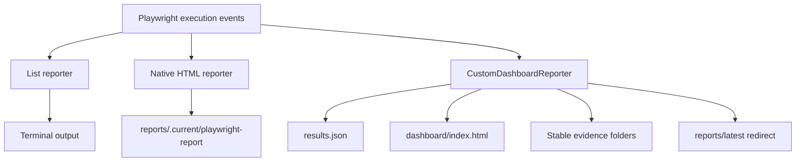
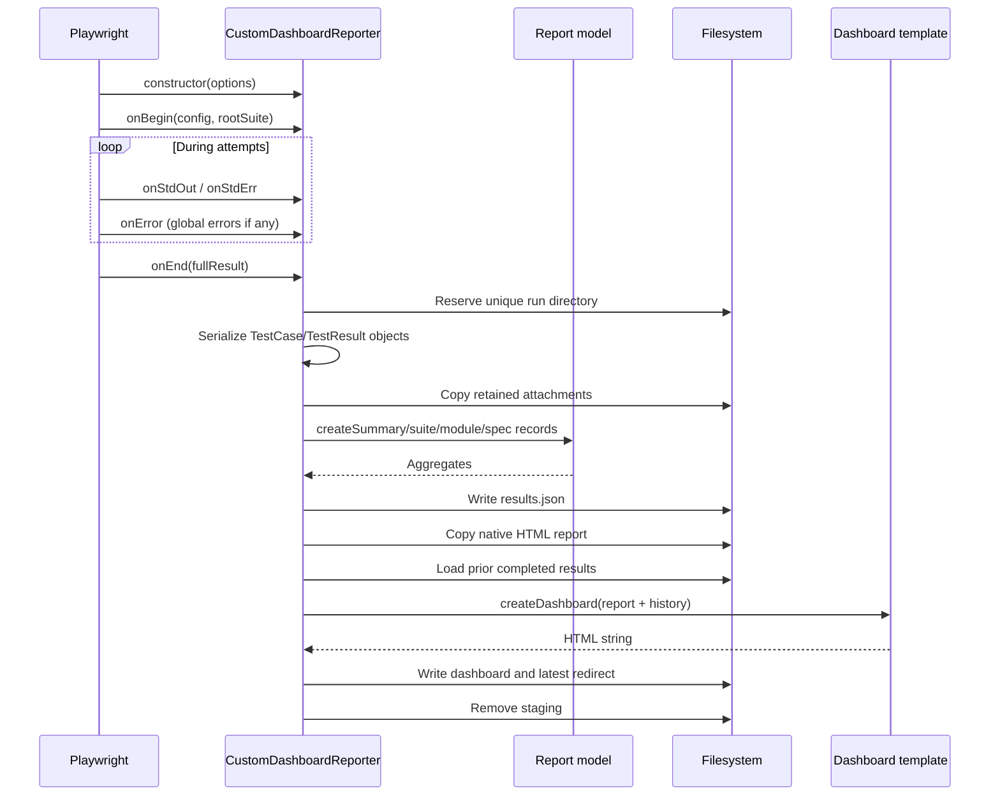
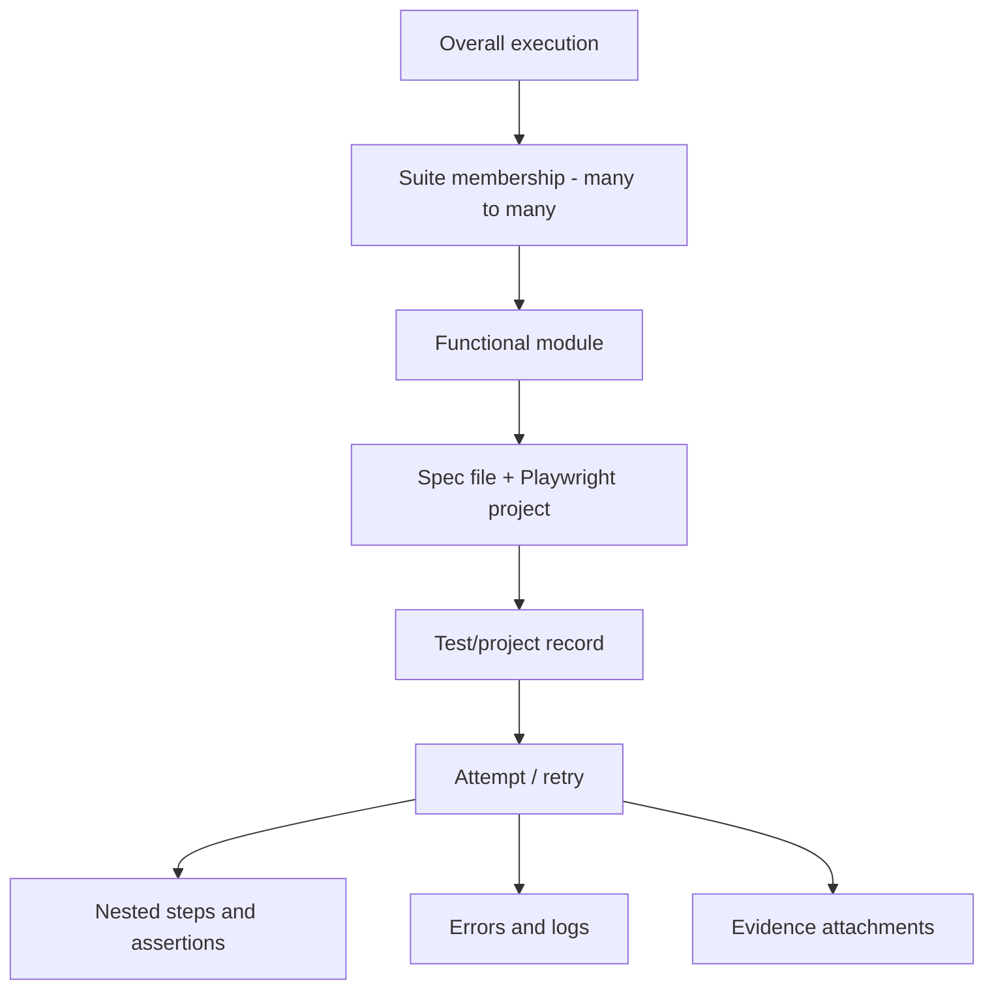
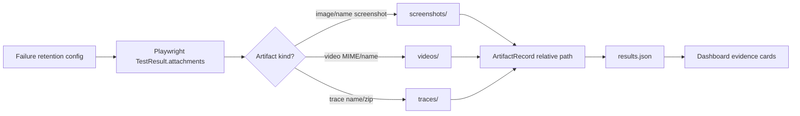

# 08 — Debugging and Custom Reporting Architecture

## Learning objectives

After this lesson, you should be able to:

1. Select the right debugging tool for a failure symptom.
2. Explain how screenshots, videos, traces, JSON, native HTML, and the custom dashboard are produced.
3. Follow Playwright Reporter API lifecycle data into schema-v2 output.
4. Debug the intentionally failing login test from evidence instead of guessing.

## Debugging principle: classify before editing

Use evidence to classify the likely owner:

| Category | Example |
|---|---|
| Application defect | Correct credentials are rejected by SauceDemo. |
| Automation defect | Login button locator no longer identifies the intended control. |
| Test-data defect | Wrong account/password supplied. |
| Environment defect | DNS/network/base URL prevents navigation. |
| Requirement mismatch | Test expects copy the product is not supposed to show. |
| External dependency failure | Public SauceDemo service is unavailable. |

Changing a selector before classification can turn a clear assertion mismatch into a brittle locator workaround.

## Debug in increasing depth

```bash
# 1. Re-run one scenario with one worker.
npx playwright test --grep "standard user can log in" --workers=1

# 2. Watch the browser.
npm run test:headed

# 3. Use Playwright Inspector and step execution.
npm run test:debug

# 4. Log Playwright API/actionability details.
DEBUG=pw:api npx playwright test --grep "standard user" --workers=1

# 5. Capture traces for every test in this investigation.
npm run test:trace

# 6. Open a trace archive.
npx playwright show-trace reports/<run-id>/traces/<trace-file>.zip

# 7. Open the newest completed custom dashboard.
npm run report
```

Use the smallest command that reproduces the problem, then expand scope after understanding it.

## Evidence types and their jobs

| Evidence | Best question it answers | Limitation |
|---|---|---|
| Assertion error/call log | What expected/received value or locator condition failed? | Does not show the entire timeline. |
| Screenshot | What did the final page visually show? | One instant; no timing/network history. |
| Video | What visual sequence occurred? | Limited DOM/locator/network internals. |
| Trace | What actions, DOM snapshots, network, console, and timings occurred? | Larger artifact; requires Trace Viewer. |
| `results.json` | What were the machine-readable tests, attempts, statuses, steps, and artifact paths? | Not optimized for visual reading. |
| Native HTML report | What did Playwright capture using its official reporter? | Different hierarchy from custom dashboard. |
| Custom dashboard | How do suite/module/spec/test/history views relate? | It organizes evidence; it does not diagnose root cause automatically. |

## Configured artifact policy

From `playwright.config.ts:48-56`:

```ts
use: {
  baseURL,
  testIdAttribute: "data-test",
  actionTimeout: 10_000,
  navigationTimeout: 15_000,
  trace: "retain-on-failure",
  screenshot: "only-on-failure",
  video: "retain-on-failure",
},
```

Important accuracy point: the trace policy is **retain on failure**, not “on first retry.” Local retries are zero by default, yet the intentional failure still retains a trace.

`npm run test:trace` adds `--trace on`, overriding the normal policy for that invocation and retaining traces for passing tests too.

## Three reporters run together

Configured at `playwright.config.ts:21-42`:



### List reporter

Prints concise progress and results to the terminal.

### Native HTML reporter

Writes Playwright's official HTML report into staging. The custom reporter later copies it into the immutable run directory.

### Custom reporter

Collects the repository-specific hierarchy, attempts, nested steps, errors, logs, attachments, history, and metadata.

## Reporting source map

| File | Responsibility |
|---|---|
| `reporting/run-context.ts` | Absolute report paths, staging directories, environment, and `Asia/Kolkata`. |
| `reporting/report-types.ts` | Schema-v2 TypeScript contracts. |
| `reporting/report-model.ts` | Pure suite/module classification and summary aggregation. |
| `reporting/custom-reporter.ts` | Reporter lifecycle, serialization, redaction, evidence copying, history, and filesystem output. |
| `reporting/dashboard-template.ts` | Self-contained HTML/CSS/client JavaScript. |
| `reporting/report-model.test.cjs` | Unit tests for classification, counting, project isolation, HTML controls, and embedded-client syntax. |

## Reporter lifecycle



### Key lifecycle methods

| Method | Lines | Purpose |
|---|---:|---|
| `onBegin` | 63-66 | Saves full config and root suite for final serialization. |
| `onError` | 68-70 | Captures errors not owned by a normal test result. |
| `onStdOut` / `onStdErr` | 72-78 | Associates redacted logs with a specific `TestResult`. |
| `onEnd` | 80-142 | Creates the immutable report and finalizes every output. |
| `serializeTest` | 144-188 | Builds one project-aware `TestRecord`. |
| `serializeAttempt` | 190-215 | Preserves each attempt's errors, steps, logs, and artifacts. |
| `serializeStep` | 232-243 | Recursively maps nested Playwright steps. |
| `serializeError` | 245-261 | Cleans ANSI, redacts, and extracts expected/actual. |
| `copyEvidence` | 293-347 | Copies screenshot/video/trace to stable folders. |
| `loadHistory` | 357-407 | Reads valid completed prior `results.json` files. |
| `updateLatestRedirect` | 409-425 | Points a stable path to the newest completed dashboard. |

## Schema-v2 hierarchy and identity



### Unique overall record

Each `TestRecord` is stored once. Its `suites` array may include both `sanity` and `regression`.

Therefore:

- overall metrics count the record once;
- Sanity includes the record once;
- Regression includes the same record once;
- adding Sanity and Regression totals can exceed overall total by design.

### Project-qualified specs

A spec key is:

```text
<source-file>::<project-name>
```

This prevents future Chromium and Firefox executions of the same source file from being merged.

### Classification rules

- `@sanity` and `@regression` become direct suite memberships.
- `@suite:<name>` supports an additional suite without dashboard code changes.
- `@module:<name>` is the preferred functional module.
- Otherwise, module falls back to directory beneath `tests/`, then spec basename.
- `@demo` is operational metadata, not a suite.

## How evidence is generated and copied



`copyEvidence`:

1. identifies supported artifact type by MIME/name/path;
2. creates a safe filename from test title and stable test ID;
3. includes retry index and attachment index;
4. copies file or attachment body;
5. returns a relative path that the dashboard can open.

Passing tests normally have no retained screenshot/video/trace under the configured failure-only policy. “No evidence captured” can therefore be correct, not a reporter bug.

## Report directory lifecycle

```text
reports/
├── .current/                         # temporary staging while run is active
├── DD-MMM-YYYY_hh-mm-AM-or-PM/
│   ├── dashboard/index.html          # custom self-contained dashboard
│   ├── playwright-report/            # copied native report
│   ├── results.json                  # schema-v2 machine-readable result
│   ├── screenshots/
│   ├── videos/
│   └── traces/
├── <older completed runs>/
└── latest/index.html                 # redirect to newest completed run
```

The run directory is reserved atomically. If a same-minute name already exists, the reporter advances the folder label by one minute instead of overwriting evidence.

Stored timestamps are ISO UTC values. Run folder labels and dashboard display use `Asia/Kolkata`/IST.

## Dashboard generation and safety

`createDashboard` at `reporting/dashboard-template.ts:10-678` generates one HTML string containing:

- styles;
- escaped report JSON;
- filter/drill-down markup;
- client-side rendering functions;
- evidence links and media elements;
- history/trend rendering.

Before embedding JSON, `safeJson` replaces `<`, `>`, and `&`. Captured test text cannot safely be inserted directly into an HTML `<script>` context without this escaping.

Client rendering also uses `textContent` for captured values, reducing markup-injection risk.

## Debugging the intentional failure

Actual assertion at `tests/demo/login-intentional-failure.spec.ts:16-21`:

```ts
await expect(
  loginPage.errorMessage,
  "Intentional demo assertion: SauceDemo should reject invalid credentials, but this expected copy is deliberately wrong.",
).toContainText("Account locked after invalid login");
```

Observed schema-v2 run `26-Oct-2026_11-06-PM` recorded:

| Evidence | Value |
|---|---|
| Expected substring | `Account locked after invalid login` |
| Received text | `Epic sadface: Username and password do not match any user in this service` |
| Locator behavior | Resolved repeatedly to the error element |
| Earlier actions | Navigation, username fill, password fill, Login click passed |
| Result | 2 passed, 1 intentional failure, 66.7% pass rate |
| Retained artifacts | Screenshot, WebM video, trace ZIP |

### Correct diagnosis

The locator is not broken: it repeatedly resolves. The click is not broken: the application displays an authentication error. Waiting longer cannot make the wrong expected string appear. This is an intentionally incorrect test expectation.

### Evidence-first investigation order

1. Read the first error and expected/received values.
2. Identify the last passing step.
3. Inspect the locator call log.
4. Inspect screenshot for final visual state.
5. Use trace for DOM/action/network/console timeline.
6. Use video if visual timing or overlays matter.
7. Compare native/custom report scopes and prior runs.
8. Classify ownership before editing code.

## Symptom-to-tool guide

| Symptom | First evidence/tool |
|---|---|
| `ERR_NAME_NOT_RESOLVED` | Base URL, DNS/network, external availability |
| Locator timeout | Call log, Inspector, trace DOM snapshot |
| Actionability timeout | `DEBUG=pw:api`, trace action details |
| Wrong URL after click | Trace network/navigation, credentials, app response |
| Wrong text with resolved locator | Expected/received, requirement/product copy |
| Only parallel runs fail | Worker IDs, shared account/backend/file state |
| Passes only on retry | First-attempt trace/evidence; classify flaky |
| Tests run but report missing | Reporter terminal exception and staging paths |
| Dashboard control does nothing | Browser console and report-model/template unit tests |

## Reporting verification commands

```bash
# Pure classification, aggregation, HTML contracts, embedded script syntax
npm run test:reporting

# Static TypeScript checks for reporter/model/template source
npm run typecheck

# Two production-style tests; verifies reporter output without demo failure
npm run test:regression

# All three; nonzero is expected only from the deliberate demo assertion
npm test
```

## What the custom report does not claim

- It does not automatically determine root cause.
- “Previously observed” means the stable ID failed in available local history only.
- Missing historical folders make history incomplete.
- Legacy schema-v1 runs cannot provide inferred suite snapshots.
- A polished dashboard cannot make incorrect source data or expectations correct.

## Comprehension questions

### 1. Why does the intentional failure have a screenshot/video/trace but a passing test usually does not?

**Answer:** The configured policies retain those artifacts on failure. Passing artifacts are discarded unless a CLI override such as `--trace on` is used.

### 2. Why can Sanity and Regression totals overlap without overall double-counting?

**Answer:** One unique `TestRecord` stores multiple suite memberships. Overall counts the record once; each suite view counts the same record within its membership subset.

### 3. If the dashboard fails to render, does that prove the test did not execute?

**Answer:** No. Test execution and reporter presentation are separate. Inspect terminal output, `results.json`, staging/native report, and reporter exceptions to find where finalization failed.

## Related lessons

- [04 — Execution Flow](04-execution-flow.md)
- [09 — Code Review Checklist](09-code-review-checklist.md)
- [10 — Interview and Practice Questions](10-interview-and-practice-questions.md)
