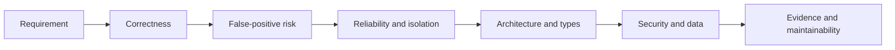

# 09 — Senior SDET Code-Review Checklist

## Learning objectives

After this lesson, you should be able to:

1. Review automation for correctness before style.
2. Identify false-positive, flakiness, isolation, architecture, and security risks.
3. Review custom reporting without confusing presentation with test truth.
4. Separate blocking findings from maintainability suggestions.

## Review in risk order



Do not spend the review on formatting while a test can pass without proving its requirement.

## 1. Scenario and requirement correctness

- [ ] Does the test name describe user-observable behavior?
- [ ] Is the setup a valid precondition rather than part of the result?
- [ ] Does each action represent a real user workflow?
- [ ] Do assertions prove the intended outcome?
- [ ] Is negative behavior asserted, not merely “no navigation happened”?
- [ ] Could the test pass while the feature is still broken?
- [ ] Are requirement assumptions visible and current?

### Current framework example

The valid test checks both:

```ts
await expect(page).toHaveURL(/\/inventory\.html$/);
await expect(page.getByTestId("title")).toHaveText("Products");
```

This proves destination and content. Checking only that the Login click did not throw would be a false-positive risk.

### Reviewer question

> What production defect would make this assertion fail?

If there is no meaningful answer, the assertion may not provide business confidence.

## 2. Reliability and synchronization

- [ ] Are all asynchronous actions and assertions awaited?
- [ ] Are fixed sleeps absent?
- [ ] Do actions rely on Playwright actionability rather than forced interaction?
- [ ] Do assertions use web-first matchers?
- [ ] Are timeout changes local and evidence-based?
- [ ] Are retries treated as evidence of flakiness rather than success?
- [ ] Does the test pass repeatedly and in parallel where appropriate?

### Blocking review example

Proposed change:

```ts
await page.waitForTimeout(5000);
await expect(title).toHaveText("Products");
```

Review finding:

> Blocking: the fixed wait adds five seconds to every run and still fails when rendering exceeds the guessed delay. `toHaveText` already retries the condition. Please attach the first-attempt trace and fix the observed readiness/state problem instead.

This explains impact, evidence, and a safer direction.

## 3. Isolation and parallel safety

- [ ] Does each test receive fresh browser state?
- [ ] Is any global mutable variable shared across tests?
- [ ] Can tests mutate the same external account/entity?
- [ ] Does one test depend on another's execution order?
- [ ] Is cleanup guaranteed after failure?
- [ ] Could two independent Playwright invocations contend for the same path/resource?

The current browser contexts are isolated, but SauceDemo accounts are public external state. Context isolation does not solve server-side collisions.

## 4. Locator quality

- [ ] Prefer role/label/placeholder/test ID based on a stable contract.
- [ ] Is the locator unique under strict resolution?
- [ ] Does it reflect user-visible/accessibility meaning where practical?
- [ ] Are `.first()`, `.nth()`, XPath, and CSS structure justified?
- [ ] Is `{ force: true }` justified by a real requirement?
- [ ] Would localization or product-copy changes intentionally break this locator?

### Current locator strengths

- Login button uses role and exact accessible name.
- Inputs use exact visible placeholders.
- Error uses the configured `data-test` automation contract.

### Current locator risks

- English copy is part of the contract.
- Placeholder changes will require page-object maintenance.
- Accessibility-name regressions can break role-based selection—which may be useful defect evidence.

## 5. Assertion quality

- [ ] Does matcher strictness match the requirement?
- [ ] Is exact text used only when the entire copy matters?
- [ ] Are regexes anchored appropriately?
- [ ] Are multiple signals used where one could produce a false positive?
- [ ] Are custom assertion messages actionable and truthful?
- [ ] Does a failed assertion preserve useful expected/received evidence?

The demo's custom message explicitly states that the expectation is deliberately wrong. This prevents a reader from misclassifying the known failure as a product bug.

## 6. Page Object Model review

- [ ] Does each page object own one cohesive UI area?
- [ ] Are locators and interaction mechanics centralized?
- [ ] Are business outcomes visible in specs?
- [ ] Are methods named for user intent rather than generic clicks/fills?
- [ ] Are public locators exposed only when useful?
- [ ] Is a base class justified by demonstrated repeated behavior?
- [ ] Does the constructor avoid async side effects?

### Good current boundary

```text
LoginPage.login(...)      -> how credentials are submitted
login.spec.ts assertions -> what success/failure means
```

### Over-abstraction warning

Do not add `BasePage`, factories, service locators, or generic click wrappers for a one-page framework unless real duplication justifies them.

## 7. Fixture review

- [ ] Is the custom `test` imported by consumers?
- [ ] Are fixture types explicit?
- [ ] Is fixture scope appropriate (test versus worker)?
- [ ] Is setup minimal and visible?
- [ ] Does teardown run after both pass and failure?
- [ ] Does the fixture avoid imposing scenario-specific login state?

The current `loginPage` fixture is test-scoped because it depends on the built-in test-scoped `page`. It correctly avoids auto-login.

## 8. TypeScript review

- [ ] Does strict type checking pass?
- [ ] Are `any`, unsafe casts, and non-null assertions avoided?
- [ ] Are optional values handled explicitly?
- [ ] Do types match persisted JSON/runtime data?
- [ ] Are type-only imports used where appropriate?
- [ ] Is `Readonly` understood as compile-time protection only?
- [ ] Are function return types and Promise behavior clear?

Type correctness is necessary but not sufficient. A locator string is type-correct even when it matches no live element.

## 9. Test data and security review

- [ ] Are real secrets absent from source and `.env.example`?
- [ ] Are CI credentials injected from a secret store?
- [ ] Are secrets absent from titles, steps, logs, errors, and attachments?
- [ ] Is report redaction treated as defense-in-depth?
- [ ] Are blank/missing values validated?
- [ ] Could environment overrides target the wrong deployment?
- [ ] Can public/shared accounts change outside this repository?

## 10. Configuration review

- [ ] Does `testDir` include intended specs only?
- [ ] Are CLI tag filters correct?
- [ ] Are local and CI worker/retry choices intentional?
- [ ] Does `forbidOnly` protect CI?
- [ ] Are timeouts bounded and justified?
- [ ] Are browser projects and claimed coverage consistent?
- [ ] Are failure artifact policies appropriate for storage/debugging needs?

Current limitation: only Chromium is configured. A document or PR must not claim cross-browser coverage merely because Playwright supports it.

## 11. Custom reporter review

- [ ] Does the reporter observe rather than change test outcomes?
- [ ] Is each test/project result unique overall?
- [ ] Can one test belong to multiple suites without cloning?
- [ ] Are spec keys project-qualified?
- [ ] Are retry attempts preserved separately?
- [ ] Are error, step, log, and attachment fields optional where necessary?
- [ ] Are captured values escaped/redacted before HTML storage/rendering?
- [ ] Are only completed reports used for history?
- [ ] Does `latest` update only after successful finalization?
- [ ] Are dashboard insights accurately limited to available history?

### Counting review example

If two tests are both Sanity and Regression, expected totals are:

```text
Overall unique tests: 2
Sanity membership:    2
Regression membership: 2
Sum of suite totals:  4 (not an overall count)
```

Review aggregate source code and unit tests if the dashboard counts differ.

## 12. Evidence before approval

- [ ] `npm run typecheck` passes.
- [ ] `npm run test:reporting` passes for reporting changes.
- [ ] Relevant focused test command passes.
- [ ] `npm run test:regression` passes for framework changes.
- [ ] Parallel/repeat checks support reliability claims when relevant.
- [ ] First-attempt artifacts support any flaky failure investigation.
- [ ] Documentation file/line references match current source.
- [ ] The known `npm test` nonzero result is attributed only to the intentional demo.

## Finding severity guide

| Severity | Example |
|---|---|
| Blocking correctness | Test can pass while login is broken. |
| Blocking reliability | Unawaited action causes nondeterministic behavior. |
| Blocking security | Secret written into source/report log. |
| Blocking reporting | Overall count double-counts suite memberships. |
| Important maintainability | Selector duplicated across several specs. |
| Suggestion | Rename local variable for clarity. |

Be explicit about severity and impact. Not every preference should block a change.

## Practice review

Review this hypothetical change:

```ts
test("login", async ({ page }) => {
  await page.goto("https://www.saucedemo.com");
  await page.locator("#user-name").fill("standard_user");
  await page.locator("#password").fill("secret_sauce");
  await page.waitForTimeout(5000);
  await page.locator("#login-button").click({ force: true });
  await expect(page.locator("body")).toContainText("Product");
});
```

Findings:

1. Duplicates page mechanics and hard-codes the environment URL/data.
2. Uses implementation selectors despite an existing page object.
3. Hard-codes a credential in scenario source.
4. Adds a fixed sleep before—not after—the action it supposedly waits for.
5. Force-click can hide an unusable button.
6. Body substring assertion is broad and could false-pass.
7. Test name does not describe a user outcome.

## Comprehension questions

### 1. Which should block first: a naming preference or a false-positive assertion?

**Answer:** The false-positive assertion. Correctness and escaped-defect risk outrank style preferences.

### 2. Why is a passing retry not enough evidence for approval?

**Answer:** It preserves evidence of instability. Review the first-attempt failure and classify the test flaky rather than treating the final green attempt as a fix.

### 3. Why should a reporter PR include unit tests and browser/report checks?

**Answer:** Pure classification/counting and generated-script contracts are efficiently tested without browsers, while real report rendering/links require runtime output. Neither layer alone proves the whole pipeline.

## Related lessons

- [06 — Page Object Model](06-page-object-model.md)
- [08 — Debugging and Reporting](08-debugging-and-reporting.md)
- [10 — Interview and Practice Questions](10-interview-and-practice-questions.md)
