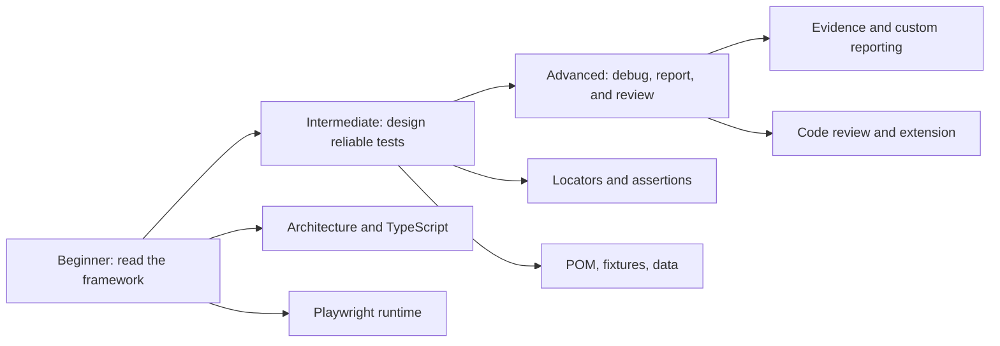

# 10 — Interview Questions and Practical SDET Exercises

This lesson consolidates the framework into beginner, intermediate, and advanced practice. Answer before opening the model answer.

## Recommended learning path



---

## Beginner questions

### 1. Trace the valid login test end to end.

Cover command, config, collection, fixtures, navigation, data, action, assertion, teardown, and reporting.

<details>
<summary>Model answer</summary>

`npm run test:regression` starts Playwright with regression/demo filters. Playwright evaluates config and discovers the spec. Imports register the suite/hook/tests and build user data. A worker creates a fresh context/page. The custom fixture constructs `LoginPage`. `beforeEach` navigates to `/`. The test passes standard data into `login`, which fills username/password and clicks. The spec checks inventory URL and title. Playwright tears down test fixtures and supplies final results/attachments to list, native HTML, and custom reporters.

</details>

### 2. Why import `test` from `../fixtures`?

<details>
<summary>Model answer</summary>

That `test` extends Playwright's base test with the typed `loginPage` fixture. Importing directly from `@playwright/test` would not provide the custom fixture.

</details>

### 3. What is the difference between a `Page` and `LoginPage`?

<details>
<summary>Model answer</summary>

`Page` is Playwright's browser-tab API. `LoginPage` is this repository's class that composes one Page and gives login-specific locators/actions.

</details>

### 4. What does `Promise<void>` mean?

<details>
<summary>Model answer</summary>

The method completes asynchronously and resolves without a business return value. It can still reject when a browser action fails.

</details>

### 5. Why are locators created in the constructor but not resolved there?

<details>
<summary>Model answer</summary>

Playwright Locators are lazy query plans. They resolve against the current DOM only when an action/assertion consumes them, reducing stale-element problems.

</details>

### Beginner comprehension check

1. **Which file owns Login button identity?** `pages/LoginPage.ts`.
2. **Which file owns the expected inventory outcome?** `tests/login.spec.ts`.
3. **Which file selects retries/workers/artifacts?** `playwright.config.ts`.

---

## Intermediate questions

### 6. Explain `await use(new LoginPage(page))`.

<details>
<summary>Model answer</summary>

The fixture constructs the value during setup, passes it into dependent hooks/test callbacks through `use`, then resumes after those callbacks complete so teardown code could run. Playwright resolves the built-in page first because the fixture destructures it as a dependency.

</details>

### 7. Auto-waiting versus web-first assertions?

<details>
<summary>Model answer</summary>

Action auto-waiting checks whether a target can be acted on (unique, visible, stable, enabled, editable as relevant). A web-first assertion repeatedly reads browser state until the expected condition becomes true or its timeout expires.

</details>

### 8. Why use URL plus title for valid login?

<details>
<summary>Model answer</summary>

The URL proves navigation to the expected route; the title proves meaningful destination content rendered. Either alone gives weaker evidence and can false-pass some broken states.

</details>

### 9. Why does the error use `toContainText` instead of exact full text?

<details>
<summary>Model answer</summary>

The stable behavior-defining phrase is `Username and password do not match`. SauceDemo adds decorative/extra copy. Substring matching preserves the requirement without coupling to irrelevant wording.

</details>

### 10. The suite passes serially and fails in parallel. What do you investigate?

<details>
<summary>Model answer</summary>

Shared server-side account/entity state, filesystem paths, global mutable variables, worker-specific timing, environment limits, and cleanup. Fresh browser contexts isolate cookies/storage, not remote shared data.

</details>

### 11. What happens when an environment credential is whitespace?

<details>
<summary>Model answer</summary>

`??` keeps the defined whitespace string, then `readEnv` rejects it after `trim()`. Because users are built during import, collection fails before browser interaction.

</details>

### Intermediate comprehension check

1. **Why avoid `waitForTimeout`?** It waits for time rather than the required condition and is both slower and still flaky.
2. **Why avoid force-click?** It can bypass actionability and hide a real user-facing defect.
3. **Why not auto-login in the fixture?** Negative login and explicit demo scenarios need logged-out state and visible behavior.

---

## Advanced questions

### 12. Explain the custom reporter lifecycle.

<details>
<summary>Model answer</summary>

Config constructs the reporter with paths/metadata. `onBegin` captures config/root suite. Output/error callbacks collect logs/global errors during execution. `onEnd` reserves a run directory, serializes TestCases and attempts, copies retained attachments, calculates aggregates, writes schema-v2 JSON, copies the native report, loads history, renders the dashboard, updates latest, and removes staging.

</details>

### 13. How does the dashboard avoid double-counting tests in two suites?

<details>
<summary>Model answer</summary>

It stores one unique test/project record with a `suites` array. Overall summaries use the unique test array. Each suite summary filters that array by membership. Suite totals intentionally overlap but overall does not clone records.

</details>

### 14. Why include project name in a spec key?

<details>
<summary>Model answer</summary>

The same source spec can execute in multiple Playwright projects/browsers. `<path>::<project>` prevents Chromium and future Firefox records from being merged into one spec aggregate.

</details>

### 15. Why does the intentional demo failure prove the locator works?

<details>
<summary>Model answer</summary>

Its call log shows repeated successful resolution to the error element and a stable received string. The mismatch is between expected and actual text, not inability to find the element.

</details>

### 16. How are screenshot, video, and trace generated?

<details>
<summary>Model answer</summary>

Playwright's `use` policy retains those artifacts on failure and exposes them as TestResult attachments. The custom reporter identifies supported attachment kinds, copies files/bodies into stable run folders, and writes relative paths into each AttemptRecord for dashboard rendering.

</details>

### 17. Why is report redaction not enough security?

<details>
<summary>Model answer</summary>

It knows only selected literal values and password-like patterns. Secrets can appear in unknown encodings/contexts. Prevention—never logging secrets—is the primary control; redaction is backup.

</details>

### Advanced comprehension check

1. **Who determines pass/fail?** Playwright Test through action/assertion outcomes; the reporter serializes it.
2. **What does a flaky result mean?** An earlier attempt failed and a retry passed.
3. **Is local history complete analytics?** No; it includes only valid result files currently available on disk.

---

## Practical exercise 1 — Add locked-out user coverage

Do not implement this exercise without first defining expected behavior.

### Plan

1. Confirm SauceDemo's documented locked-out behavior.
2. Add a typed `lockedOut` credential entry to `test-data/users.ts`.
3. Add a scenario in `tests/login.spec.ts` using the existing fixture/POM.
4. Assert the stable error behavior in the spec.
5. Reuse `@regression` and `@module:authentication`; decide whether it belongs in Sanity.
6. Run focused test, typecheck, then regression.

### Review questions

- Does `LoginPage` need to change? Usually no—the interaction is identical.
- Does the reporter need to change? No—it is data-driven for new tests/tags.
- Is a new fixture needed? No—the existing page-object fixture is sufficient.

## Practical exercise 2 — Add Firefox carefully

### Plan

1. Add a Firefox project in `playwright.config.ts`.
2. Install the Firefox binary.
3. Run the passing regression suite in both projects.
4. Confirm results remain separate by project and spec key.
5. Compare browser-specific failures before changing assertions.
6. Update documentation only after verification.

### Expected reporter behavior

No model change should be required. `serializeTest` already reads project/browser identity, and spec keys include project name.

## Practical exercise 3 — Debug a controlled title mismatch

1. Change `Products` to `All Products` at `tests/login.spec.ts:19`.
2. Run only the valid test with one worker.
3. Read expected/received and call log.
4. Inspect screenshot and trace.
5. Confirm login actions passed before the assertion.
6. Restore the original assertion.

### Expected diagnosis

The page object and title locator work; the deliberately changed expected requirement is wrong.

## Practical exercise 4 — Review a poor test

Use the checklist in Lesson 09 against:

```ts
test("login", async ({ page }) => {
  await page.goto("https://www.saucedemo.com");
  await page.locator("#user-name").fill("standard_user");
  await page.locator("#password").fill("secret_sauce");
  await page.waitForTimeout(5000);
  await page.locator("#login-button").click({ force: true });
  await expect(page.locator("body")).toContainText("Product");
});
```

Minimum findings:

- unclear test name;
- duplicated selectors/actions;
- hard-coded URL and credential;
- fixed sleep;
- forced action;
- weak body-level assertion;
- bypasses custom fixture/page object/data boundaries.

## Practical exercise 5 — Trace a report record

Open a stored `results.json` and find:

1. Run ID/status/timezone.
2. Overall summary.
3. Suite membership totals.
4. Module/spec key.
5. Stable failed test ID.
6. Attempt retry/status/duration.
7. Failed step and expected/actual.
8. Screenshot/video/trace relative paths.

Then locate the corresponding rendering functions in `reporting/dashboard-template.ts`.

## Scenario-based interview prompts

### Login click succeeds, URL assertion times out

Potential hypotheses:

- credentials are wrong;
- application rejected login without expected error handling;
- redirect/navigation behavior changed;
- wrong base environment;
- external service degradation;
- assertion pattern no longer matches requirement.

Evidence: trace network and page snapshots, error UI, received URL, and credentials source—without printing secrets.

### CI passes only on retry

Do not say “CI is green.” State that the outcome is flaky, inspect the first-attempt trace, compare timing/shared-state/environment factors, and reproduce under the relevant worker/retry settings.

### Dashboard total differs from sum of suite cards

First ask whether tests have multiple suite memberships. Overall unique total should not equal the sum of overlapping suite views. Verify `TestRecord.suites`, `createSummary`, and `createSuiteRecords` before calling it a defect.

### Screenshot exists but dashboard image is broken

Trace the pipeline:

1. attachment path/body in TestResult;
2. copied file destination;
3. ArtifactRecord relative path in `results.json`;
4. dashboard location and generated ``;
5. filesystem existence/permissions.

## Final self-assessment

You are ready to extend/review this framework when you can explain, without memorizing:

- why collection and execution differ;
- why page objects hide mechanics but specs retain outcomes;
- how fixture `use` defines lifecycle;
- how locators/actionability/assertion retrying differ;
- why one test can belong to two suites but count once overall;
- how failure artifacts flow from config to Playwright to custom report;
- why the intentional demo is an expectation mismatch;
- which claims are implemented facts versus possible Playwright features.

## Related lessons

- [01 — Framework Architecture](01-framework-architecture.md)
- [08 — Debugging and Reporting](08-debugging-and-reporting.md)
- [09 — Code Review Checklist](09-code-review-checklist.md)
